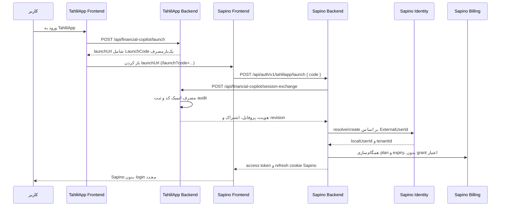

# قرارداد یکپارچه‌سازی TahlilApp و Sapino

**وضعیت سند:** قرارداد پیشنهادی برای هماهنگی و آماده‌سازی staging؛ این سند وجود یا دسترس‌پذیری endpointهای TahlilApp را تأیید نمی‌کند.

**منبع رفتار فعلی Sapino:** پیاده‌سازی موجود Feature 139. هر موردی که با وضعیت «پیشنهادی»، «تأییدنشده» یا «نیازمند تغییر هماهنگ» مشخص شده، هنوز قرارداد اجرایی مشترک محسوب نمی‌شود.

## ۱. دامنه و نقش سامانه‌ها

جریان ورود بدون ورود مجدد باید به این ترتیب کار کند:

- **TahlilApp Frontend:** کاربر را احراز می‌کند و از Backend خود برای ساخت یک `LaunchCode` یک‌بارمصرف درخواست می‌کند.
- **TahlilApp Backend:** مالک نشست TahlilApp، صدور و مصرف اتمیک `LaunchCode`، منبع حقیقت اشتراک TahlilApp و endpointهای server-to-server است.
- **Sapino Frontend:** مسیر `/launch` را باز می‌کند، `code` را به Sapino Backend می‌فرستد و فقط نشست صادرشده Sapino را نگه می‌دارد.
- **Sapino Backend:** کد را با TahlilApp Backend exchange می‌کند، هویت محلی را provision یا resolve می‌کند، اشتراک را در Billing همگام می‌کند و نشست Sapino می‌سازد.
- **Sapino Identity:** نگاشت پایدار `(Provider=TahlilApp, ExternalUserId)` به یک local user و tenant، پروفایل، refresh token و access token Sapino را نگه می‌دارد.
- **Sapino Billing:** plan، پنجره انقضا و wallet/ledger را نگه می‌دارد. TahlilApp منبع wallet balance یا credit مصرف‌شده Sapino نیست.

### توالی اولین ورود



## ۲. شمارش endpointهای قرارداد

این سند چهار endpoint اصلی یکپارچه‌سازی را مستند می‌کند:

1. `POST /api/financial-copilot/launch` در TahlilApp Backend — پیشنهادی و متعلق به تیم TahlilApp.
2. `POST /api/financial-copilot/session-exchange` در TahlilApp Backend — قرارداد server-to-server پیشنهادی/نیازمند تأیید TahlilApp.
3. `GET /api/financial-copilot/users/{externalUserId}/status` در TahlilApp Backend — قرارداد پیشنهادی برای refresh.
4. `POST /api/auth/v1/tahlilapp/launch` در Sapino Backend — endpoint پیاده‌سازی‌شده Sapino.

Endpointهای native احراز هویت Sapino مانند `login`، `refresh`، `logout`، enrollment ایمیل و password reset بخشی از قرارداد TahlilApp نیستند؛ در checklist برای E2E پوشش داده می‌شوند.

## ۳. صدور LaunchCode در TahlilApp

### `POST /api/financial-copilot/launch`

این endpoint باید فقط در TahlilApp Backend پیاده‌سازی و منتشر شود. در repository فعلی Sapino وجود ندارد؛ بنابراین آدرس، availability و جزئیات احراز هویت آن هنوز باید توسط TahlilApp تأیید شود.

**احراز هویت و CSRF**

- فقط برای کاربر دارای نشست معتبر TahlilApp قابل فراخوانی باشد.
- درخواست مرورگر باید تحت CSRF protection همان TahlilApp باشد؛ استفاده از cookie احراز هویت به‌تنهایی کافی نیست.
- CORS، origin و SameSite policy باید با frontend واقعی TahlilApp هماهنگ شود.
- این endpoint نباید credential یا cookie مشترک با Sapino صادر کند.

**درخواست و پاسخ پیشنهادی**

درخواست، در ساده‌ترین حالت، body ندارد یا body خالی دارد. شناسه کاربر از نشست احراز‌شده TahlilApp استخراج می‌شود.

```json
{}
```

پاسخ موفق پیشنهادی:

```json
{
  "launchUrl": "https://sapino.example.com/launch?code=K6m...",
  "expiresAt": "2026-10-18T10:00:30Z"
}
```

`launchUrl` باید به Sapino Frontend (`/launch`) ختم شود و `code` را به صورت query parameter حمل کند. URL نباید token نشست، API key، refresh token یا داده PII داشته باشد.

**الزامات LaunchCode**

- حداقل ۳۲ بایت randomness رمزنگاری‌شده با CSPRNG؛ encoding URL-safe مانند Base64URL.
- طول عمر پیشنهادی حداکثر ۱۲۰ ثانیه؛ مقدار هدف برای staging برابر ۶۰ ثانیه است.
- در TahlilApp فقط hash کد ذخیره شود، نه مقدار خام آن.
- مصرف باید single-use و اتمیک باشد: هم‌زمانی دو درخواست فقط یک مصرف موفق ایجاد کند.
- رکورد باید شامل hash، `externalUserId`، زمان صدور، زمان انقضا، زمان مصرف، نتیجه و correlation id باشد.
- کد منقضی، مصرف‌شده، ناشناخته یا malformed باید پاسخ یکنواخت بدهد تا oracle ایجاد نشود.

**خطاهای پیشنهادی**

| وضعیت | معنا | داده قابل نمایش به کاربر |
|---|---|---|
| `401` | نشست TahlilApp معتبر نیست | ورود دوباره به TahlilApp |
| `403` | کاربر اجازه launch ندارد | دسترسی در دسترس نیست |
| `409` | درخواست هم‌زمان یا سیاست مصرف نقض شده | دوباره تلاش کنید |
| `429` | rate limit | بعداً تلاش کنید |
| `5xx` | خطای موقت TahlilApp | بعداً تلاش کنید |

کدهای داخلی، hash و PII نباید در پاسخ frontend یا لاگ عمومی قرار گیرند.

## ۴. Session Exchange

### `POST /api/financial-copilot/session-exchange`

این endpoint متعلق به TahlilApp Backend است و Sapino Backend آن را server-to-server فراخوانی می‌کند. در کد Sapino، path پیش‌فرض همین مقدار است و از `Authentication:TahlilApp:ExchangePath` قابل تنظیم است؛ availability واقعی آن در TahlilApp هنوز تأیید نشده است.

### احراز هویت ارتباط

- ارتباط فقط روی HTTPS با TLS معتبر انجام شود؛ redirect پذیرفته نشود.
- Sapino header زیر را ارسال می‌کند: `X-Api-Key: <service credential>`.
- Sapino همچنین `X-Correlation-Id` را ارسال می‌کند.
- کلید در environment/secret store با نام پیکربندی‌شده `ApiKeyEnvironmentVariable` خوانده می‌شود؛ مقدار پیش‌فرض `TAHLILAPP_EXCHANGE_API_KEY` است و در repository یا browser قرار نمی‌گیرد.
- TahlilApp باید API key را با زمان‌بندی rotation و امکان overlap کوتاه برای تعویض امن مدیریت کند.
- پاسخ باید `Content-Type: application/json` داشته باشد.

### DTO درخواست

```json
{
  "code": "K6m..."
}
```

در Sapino فقط property `code` خوانده می‌شود؛ propertyهای ناشناخته نباید در تعیین هویت اثر بگذارند. کد خالی، کوتاه‌تر از ۱۶ یا بلندتر از ۲۵۶ کاراکتر، یا دارای کاراکتر خارج از `[A-Za-z0-9_-]` قبل از فراخوانی TahlilApp رد می‌شود.

### DTO پاسخ فعلی که Sapino مصرف می‌کند

```json
{
  "user": {
    "externalUserId": "ta-user-1001",
    "firstName": "Sara",
    "lastName": "Test",
    "nationalId": "0012345678",
    "mobile": "+989121234567",
    "status": "Active"
  },
  "subscription": {
    "plan": "Plus",
    "isActive": true,
    "expiresAt": "2026-11-18T00:00:00Z",
    "revision": 42
  },
  "permissions": ["financial-copilot"]
}
```

### وضعیت دقیق فیلدها

| مسیر | اجباری/اختیاری | validation و رفتار فعلی Sapino |
|---|---|---|
| `user.externalUserId` | اجباری | رشته ۱ تا ۱۲۸ کاراکتر؛ فقط `[A-Za-z0-9._:-]`. تنها کلید cross-system است. |
| `user.firstName` | اختیاری | رشته معتبر پروفایل؛ مقدار غایب/نامعتبر مقدار قبلی را حفظ می‌کند. |
| `user.lastName` | اختیاری | همان سیاست `firstName`. |
| `user.nationalId` | اختیاری | در exchange قابل دریافت و در Sapino با Data Protection رمزنگاری می‌شود؛ مقدار خام و مقدار کامل در log/JWT قرار نمی‌گیرد؛ مقدار نامعتبر نادیده گرفته می‌شود. |
| `user.mobile` | اختیاری | در exchange قابل دریافت و رمزنگاری می‌شود؛ مقدار خام و مقدار کامل در log/JWT قرار نمی‌گیرد؛ مقدار نامعتبر نادیده گرفته می‌شود. |
| `user.status` | اجباری | فقط `Active` یا `Suspended`. `Suspended` باعث عدم صدور session می‌شود. |
| `subscription.plan` | اختیاری | رشته، به صورت exact با `PlanMap` مقایسه می‌شود؛ plan ناشناخته به `Free` می‌رود. |
| `subscription.isActive` | از نظر JSON اختیاری، از نظر تصمیم‌گیری | فقط مقدار boolean `true` فعال تلقی می‌شود؛ فقدان یا نوع اشتباه fail-closed و inactive است. |
| `subscription.expiresAt` | اختیاری | ISO 8601؛ نامعتبر یا خارج از افق حداکثر ۵ سال null می‌شود؛ plan paid بدون expiry به `Free` می‌رود. |
| `subscription.revision` | اختیاری | `Int64`؛ برای audit/sync state استفاده می‌شود. |
| `permissions` در root | اختیاری | اگر array باشد فقط تعداد آن (`ExternalPermissionCount`) شمرده و log می‌شود؛ نام permissionها دور ریخته می‌شوند و هیچ capability ایجاد نمی‌کنند. |

`Email` در این DTO وجود ندارد و نباید برای correlation یا identity استفاده شود. در اولین provision، local user بدون email و بدون password ساخته می‌شود. سپس کاربر می‌تواند از native enrollment استفاده کند.

### semantics پاسخ و timeout فعلی Sapino

| پاسخ TahlilApp | رفتار gateway Sapino |
|---|---|
| `2xx` + JSON معتبر | ادامه provisioning/sync/session |
| `400` | `InvalidCode`؛ به کاربر `401 launch-invalid` داده می‌شود |
| `3xx` | redirect دنبال نمی‌شود و unavailable تلقی می‌شود |
| `401/403/404/409/429/5xx` | unavailable، به جز `400` که invalid است |
| timeout/transport/content-type/JSON نامعتبر | unavailable |
| body بزرگ‌تر از ۸ KB | unavailable |

timeout exchange از ۱ تا ۱۰ ثانیه معتبر است و مقدار پیش‌فرض فعلی ۵ ثانیه است. exchange retry ندارد، چون مصرف کد non-idempotent است. Rate limit روی endpoint عمومی Sapino با policy `PublicAuthentication` اعمال می‌شود؛ عدد نهایی آن باید در staging با configuration واقعی ثبت شود.

TahlilApp باید مصرف کد را قبل از پاسخ موفق، اتمیک و concurrency-safe انجام دهد. Sapino نیز hash کد و outcome را در `auth_tahlilapp_launch_attempts` با correlation ثبت و replay را در سمت خود قبل از exchange مسدود می‌کند.

## ۵. هویت، پروفایل و نشست Sapino

- نگاشت با `(Provider = "TahlilApp", ExternalUserId)` انجام می‌شود؛ `nationalId`، `mobile` و `Email` کلید نگاشت نیستند.
- اولین ورود یک local user بدون email/password، tenant پیش‌فرض و role پایه `User` ایجاد می‌کند.
- ورود بعدی همان `externalUserId` همان local user و tenant را resolve می‌کند.
- profile field معتبر جدید جایگزین مقدار قبلی می‌شود؛ field غایب یا نامعتبر مقدار قبلی را حفظ می‌کند.
- `nationalId` و `mobile` در Data Protection با key ring پایدار رمزنگاری می‌شوند؛ UI فقط masked view دارد.
- پاسخ موفق Sapino از `POST /api/auth/v1/tahlilapp/launch` شامل `AccessToken`، `AccessTokenExpiresAt` و user profile/roles/permissions داخلی Sapino است. refresh token در cookie `financial_copilot_refresh` با `HttpOnly`، `Secure` در production و `SameSite=Strict` در path `/api/auth/v1` قرار می‌گیرد.
- access token فعلی ۱۵ دقیقه عمر دارد. logout refresh token را revoke می‌کند؛ access token stateless صادرشده تا پایان همین عمر کوتاه ممکن است معتبر بماند.

## ۶. Subscription، Billing و permissions

### منبع حقیقت و نگاشت plan

TahlilApp برای کاربران TahlilApp-origin منبع حقیقت `status`، plan، active بودن و expiry است. Sapino با `PlanMap` آن را به plan canonical داخلی نگاشت می‌کند:

| TahlilApp plan | Sapino plan | Monthly AI Credits |
|---|---|---:|
| `Free` | `Free` | 25 |
| `Plus` | `Plus` | 260 |
| `Pro` | `Pro` | 2600 |

اگر plan ناشناخته/خالی باشد، `isActive=false` باشد، expiry غایب/نامعتبر باشد یا expiry گذشته باشد، تصمیم `Free` است. plan paid فقط وقتی پذیرفته می‌شود که mapping معتبر، active و expiry آینده داشته باشد.

همگام‌سازی اشتراک idempotent است و فقط plan، `EffectiveTo` و revision/audit را به Billing می‌نویسد. sync یا upgrade/downgrade به‌خودی‌خود اعتبار ماهانه را grant یا reset نمی‌کند. wallet balance و consumed-credit ledger فقط تحت کنترل Sapino Billing است؛ TahlilApp نباید مقدار wallet، remaining credits یا مصرف را authoritative اعلام کند.

### تفکیک وضعیت واقعی فیلدها

**A — امروز در Sapino پیاده‌سازی و مصرف می‌شود**

- `externalUserId`، `firstName`، `lastName`، `nationalId`، `mobile`، `status` در exchange.
- `plan`، `isActive`، `expiresAt` و `revision` در exchange و سیاست اشتراک.
- `permissions` فقط به شکل root-level array پذیرفته و count می‌شود؛ نام‌ها مصرف یا ذخیره capability نمی‌شوند.
- `Free/Plus/Pro` و credit catalog برابر ۲۵/۲۶۰/۲۶۰۰ در مدل و migration تأییدشده repository هستند؛ migration `20261018092758_UpdateApprovedMonthlyAiCredits` هنوز روی live database اجرا نشده است.
- status refresh با GET تکی، TTL پیش‌فرض ۱۵ دقیقه، stale grace پیش‌فرض ۶ ساعت و downgrade امن به Free پیاده‌سازی شده است.

**B — برای نیاز محصول لازم است ولی امروز پیاده‌سازی نشده است**

- مصرف نام permissionها و تبدیل آن‌ها به capability/role داخلی Sapino.
- قراردادن permissionهای قابل اتکا در status response و اعمال تغییر permission بدون login مجدد.
- تعریف mapping مصوب بین permissionهای TahlilApp و capabilityهای Billing/feature authorization Sapino.
- اثبات واقعی availability و SLA endpointهای TahlilApp در staging.

**C — extension پیشنهادی و نیازمند تغییر هماهنگ**

قرارداد پیشنهادی برای permissionها باید با توافق دو تیم به شکل versioned و explicit اضافه شود؛ مثلاً:

```json
{
  "permissions": [
    { "code": "financial-copilot", "active": true, "expiresAt": null }
  ]
}
```

این DTO فعلاً قرارداد اجرایی Sapino نیست. پیش از استفاده باید schema نهایی، مالکیت تصمیم، case-sensitivity، expiry، رفتار revoke، mapping table و تست backward-compatible تصویب و در parser، persistence، authorization و status worker هر دو سمت تغییر داده شود. تغییر `permissions` به object به جای array نیز breaking change برای parser فعلی است و باید version یا rollout هماهنگ داشته باشد.

## ۷. Status endpoint و revalidation

### `GET /api/financial-copilot/users/{externalUserId}/status`

این endpoint برای login-path و background revalidation طراحی شده و در Sapino با `StatusPathTemplate` پیش‌فرض فراخوانی می‌شود. endpoint و schema هنوز از TahlilApp تأیید نشده‌اند.

احراز هویت همان `X-Api-Key` روی HTTPS و `X-Correlation-Id` است. timeout پیش‌فرض فعلی ۳ ثانیه، بدون retry، بدون redirect و با body limit هشت کیلوبایت است.

پاسخ فعلی مورد قبول parser Sapino:

```json
{
  "user": {
    "externalUserId": "ta-user-1001",
    "status": "Active"
  },
  "subscription": {
    "plan": "Pro",
    "isActive": true,
    "expiresAt": "2026-12-31T23:59:59Z",
    "revision": 43
  }
}
```

`nationalId` و `mobile` در status ممنوع‌اند؛ parser در صورت مشاهده آن‌ها response را رد می‌کند. permission field در status فعلی پشتیبانی نمی‌شود. status فقط `Active`/`Suspended`، plan، isActive، expiry و revision را منتقل می‌کند.

رفتار خطا:

- `200` با JSON معتبر: اعمال snapshot.
- `404`: identity در TahlilApp دیگر وجود ندارد؛ local identity به `Revoked` می‌رود.
- سایر non-2xx، timeout، transport، content-type یا validation error: `Unavailable`.
- status `Suspended`: local identity به `Suspended` می‌رود و launch بعدی از مسیر TahlilApp session صادر نمی‌کند. access token stateless قبلی به‌صورت خودکار revoke نمی‌شود؛ اثر روی native login، refresh و نشست‌های موجود باید در staging تأیید و با Product/Security تصمیم‌گیری شود.
- در unavailable، plan paid تا پایان stale grace شش‌ساعته با last-known state حفظ می‌شود؛ پس از آن به Free downgrade می‌شود.

worker فعلی batch داخلی تا ۱۰۰ identity را claim می‌کند، اما برای هر identity یک GET جداگانه به status endpoint می‌زند؛ به endpoint batch خارجی وابسته نیست. endpoint batch TahlilApp در این repository پیاده‌سازی یا لازم نشده است. اگر scale یا SLA نیازمند batch باشد، باید یک extension جداگانه و coordinated contract change با ownership، pagination، partial failure و idempotency تعریف شود.

## ۸. قرارداد خطا

جدول زیر semantics مورد انتظار را از failureهای قابل نمایش به کاربر جدا می‌کند. جزئیات transport، body خارجی و credential فقط در diagnostics محدود و redacted باقی می‌ماند.

| وضعیت/شرایط | رفتار یکپارچه‌سازی | خطای قابل نمایش به کاربر |
|---|---|---|
| LaunchCode نامعتبر | TahlilApp و Sapino باید invalid را بدون oracle رد کنند؛ session صادر نشود | `401 launch-invalid` |
| LaunchCode منقضی | مانند invalid؛ زمان انقضا افشا نشود | `401 launch-invalid` |
| LaunchCode مصرف‌شده | مانند invalid؛ exchange دوم انجام نشود | `401 launch-invalid` |
| user disabled یا local account disabled | Sapino provision/session را متوقف کند | `403 launch-account-disabled` |
| user suspended | exchange موفق با `status=Suspended` session launch نمی‌گیرد؛ status refresh local identity را suspended می‌کند | `403 launch-account-disabled` در launch |
| credential سرویس نامعتبر/ناقص | TahlilApp باید unauthorized بدهد؛ Sapino آن را unavailable و redacted ثبت کند | `503 launch-unavailable` |
| subscription منقضی | identity برقرار می‌ماند، plan به `Free` می‌رود و capability paid grant نمی‌شود | login موفق با Free؛ خطای auth نیست |
| plan ناشناخته/فاقد expiry معتبر | fail-closed به `Free`؛ هیچ plan بالاتری grant نمی‌شود | login موفق با Free؛ خطای auth نیست |
| rate limit | endpoint عمومی یا external service باید `429` بدهد؛ client نباید با retry خودکار مصرف را تکرار کند | `429` یا پیام کوتاه retry-later |
| timeout/transport/5xx موقت | no session از launch، بدون افشای stack/body؛ status path stale-grace را اعمال می‌کند | `503 launch-unavailable` |
| خطای داخلی provisioning/Billing | در کد فعلی handler عمومی ممکن است `500` بدهد؛ این مورد با `503` یکسان نیست و باید در staging observe شود | پیام عمومی بدون جزئیات |

این distinction مهم است: «subscription expired» و «unknown plan» داده معتبر اما کم‌امتیاز هستند و باید به Free تبدیل شوند؛ «service unavailable» خطای موقت ارتباط است و نباید plan را بی‌دلیل overwrite کند تا stale grace تمام شود.

## ۹. endpoint داخلی Sapino برای launch

### `POST /api/auth/v1/tahlilapp/launch`

درخواست:

```json
{ "code": "K6m..." }
```

موفقیت `200`:

```json
{
  "accessToken": "<opaque-to-documentation>",
  "accessTokenExpiresAt": "2026-10-18T10:15:00Z",
  "user": {
    "userId": "00000000-0000-0000-0000-000000000001",
    "email": "",
    "tenantId": "00000000-0000-0000-0000-000000000002",
    "roles": ["User"],
    "permissions": []
  }
}
```

refresh token در response JSON نیست و در cookie امن نوشته می‌شود.

| HTTP | error code | نمایش امن |
|---:|---|---|
| `404` | feature disabled | endpoint در محیط فعال نیست |
| `401` | `launch-invalid` | کد نامعتبر، منقضی یا replay شده است |
| `403` | `launch-account-disabled` | حساب در دسترس نیست |
| `503` | `launch-unavailable` | TahlilApp موقتاً در دسترس نیست |
| `429` | rate limit policy | بعداً تلاش کنید |

کدهای invalid، expired و reused عمداً یک پاسخ کاربرمحور دارند تا oracle ایجاد نشود. `correlationId` در ProblemDetails برای پشتیبانی می‌آید؛ secret، code و response body خارجی هرگز در log قرار نمی‌گیرد.

## ۱۰. هفت مثال JSON با داده مصنوعی

همه مثال‌ها synthetic هستند و credential واقعی ندارند.

### ۹.۱ کاربر Free برای اولین بار

```json
{
  "user": { "externalUserId": "ta-free-001", "status": "Active" },
  "subscription": { "plan": "Free", "isActive": true, "expiresAt": null, "revision": 1 },
  "permissions": []
}
```

نتیجه Sapino: ساخت local identity در صورت نبودن، plan=`Free`، سهم catalog برابر ۲۵؛ sync اعتباری انجام نمی‌دهد.

### ۹.۲ کاربر Plus فعال

```json
{
  "user": { "externalUserId": "ta-plus-002", "firstName": "Plus", "lastName": "Tester", "status": "Active" },
  "subscription": { "plan": "Plus", "isActive": true, "expiresAt": "2026-11-18T00:00:00Z", "revision": 20 },
  "permissions": ["financial-copilot"]
}
```

نتیجه: plan=`Plus` و expiry ثبت می‌شود؛ count permission برابر ۱ است ولی capability از نام آن ساخته نمی‌شود.

### ۹.۳ کاربر Pro فعال

```json
{
  "user": { "externalUserId": "ta-pro-003", "status": "Active" },
  "subscription": { "plan": "Pro", "isActive": true, "expiresAt": "2027-01-31T00:00:00Z", "revision": 30 },
  "permissions": ["financial-copilot", "advanced-analysis"]
}
```

نتیجه: plan=`Pro`؛ catalog برابر ۲۶۰۰ و count permission برابر ۲ است، بدون mapping capability.

### ۹.۴ کاربر suspended

```json
{
  "user": { "externalUserId": "ta-suspended-004", "status": "Suspended" },
  "subscription": { "plan": "Plus", "isActive": true, "expiresAt": "2026-12-01T00:00:00Z", "revision": 31 }
}
```

نتیجه: Sapino session صادر نمی‌کند و `403 launch-account-disabled` می‌دهد.

### ۹.۵ subscription منقضی

```json
{
  "user": { "externalUserId": "ta-expired-005", "status": "Active" },
  "subscription": { "plan": "Pro", "isActive": true, "expiresAt": "2026-10-01T00:00:00Z", "revision": 32 }
}
```

نتیجه: چون expiry گذشته است، تصمیم Sapino `Free` با reason=`expired` است.

### ۹.۶ کاربر returning

```json
{
  "user": { "externalUserId": "ta-free-001", "status": "Active" },
  "subscription": { "plan": "Free", "isActive": true, "expiresAt": null, "revision": 2 }
}
```

نتیجه: `externalUserId` موجود همان local user قبلی را resolve می‌کند؛ local user، conversation و Billing account جدید ایجاد نمی‌شود.

### ۹.۷ LaunchCode نامعتبر

درخواست Sapino Frontend به Sapino Backend:

```json
{ "code": "already-used-or-invalid" }
```

پاسخ عمومی Sapino:

```json
{
  "type": "https://financialcopilot/errors/launch-invalid",
  "title": "The launch request is invalid or has expired.",
  "status": 401,
  "correlationId": "synthetic-correlation-007"
}
```

در این حالت session صادر نمی‌شود و جزئیات invalid/expired/reused بودن در پاسخ افشا نمی‌شود.

## ۱۱. الزامات امنیتی و حریم خصوصی

- LaunchCode باید CSPRNG، کوتاه‌عمر، hash‌شده و single-use باشد؛ browser URL محل credential بلندمدت نیست.
- exchange و status فقط server-to-server روی HTTPS/TLS معتبر با `X-Api-Key` انجام می‌شود.
- API key باید در secret store/environment، قابل rotation و بدون چاپ در log باشد؛ نبودن key در Sapino fail closed و unavailable است.
- هیچ shared authentication cookie بین TahlilApp و Sapino وجود ندارد.
- Sapino قبل از exchange replay محلی را با hash و unique constraint کنترل می‌کند؛ TahlilApp نیز باید مصرف اتمیک خود را تضمین کند.
- exchange و status retry ندارند؛ timeout و body limit از حمله و مصرف منابع جلوگیری می‌کند.
- لاگ فقط outcome، status code، latency، count permission و correlation را ثبت می‌کند؛ code، API key، nationalId، mobile، email و response body ثبت نمی‌شوند.
- key ring Data Protection باید persistent، مشترک بین replicaها و با permission محدود باشد.
- `nationalId` و `mobile` حداقل داده موردنیاز هستند، رمزنگاری‌شده ذخیره می‌شوند و در status نباید برگردند.
- access token کوتاه‌عمر ۱۵ دقیقه است؛ refresh cookie `HttpOnly` و `SameSite=Strict` است.

## ۱۲. ماتریس مالکیت و acceptance criteria

| موضوع | TahlilApp team | Sapino team | DevOps/Operations | Product Owner | معیار پذیرش |
|---|---|---|---|---|---|
| Launch issuance | پیاده‌سازی و انتشار endpoint | مصرف launchUrl | DNS/TLS و routing | تأیید UX | کاربر signed-in کد کوتاه‌عمر می‌گیرد و هر کد فقط یک بار مصرف می‌شود |
| Session exchange | ارائه schema و atomic consume | gateway، parser، mapping و session | secret، firewall و observability | تأیید identity contract | first launch همان local identity را می‌سازد و replay session نمی‌دهد |
| Status | endpoint، auth، SLA و عدم PII | parser، refresh worker و safe downgrade | availability/alerts | تأیید suspension/expiry | `Active`/`Suspended` و expiry در login و worker قابل راستی‌آزمایی است |
| Subscription | plan/status/expiry/revision | PlanMap و Billing sync | migration/backup | تأیید catalog | Free=25، Plus=260، Pro=2600؛ sync اعتبار grant نمی‌کند |
| Permissions | schema و semantics | parser/authorization/Billing mapping | rollout و audit | تصویب mapping | تا پیش از توافق C، permission نام‌دار به capability تبدیل نمی‌شود |
| Profile/PII | فیلدهای مجاز | encryption/masking/native enrollment | key ring backup/restore | privacy approval | PII در log/JWT نیست و پس از restart قابل decrypt است |

## ۱۳. تصمیم‌های باز برای integration

### Blocking

1. base URL و availability واقعی `POST /api/financial-copilot/session-exchange` در staging.
2. base URL و availability واقعی `POST /api/financial-copilot/launch` و redirect به Sapino `/launch`.
3. schema نهایی، مالکیت و rotation برای `X-Api-Key`.
4. staging DNS، TLS certificate، trusted proxy و مسیر network دو Backend.
5. تأیید schema و SLA برای `GET /api/financial-copilot/users/{externalUserId}/status`.
6. اجرای کنترل‌شده auth/billing migrations در staging و ثبت evidence؛ migration credit در live هنوز اجرا نشده است.

### Non-blocking

1. متن دقیق UI برای expired/temporary unavailable.
2. ظاهر دکمه یا لینک «ورود به Sapino» در TahlilApp.
3. نام‌گذاری نهایی dashboard و alertها، تا زمانی که correlation و outcome حفظ شوند.

### Requires coordinated contract change

1. permission DTO نام‌دار، mapping به capability و رفتار revoke/expiry.
2. افزودن permission به status response.
3. endpoint batch status در صورت نیاز scale؛ شامل pagination، partial failure، rate limit و idempotency.
4. هر تغییر در envelope فعلی `user`/`subscription` یا تبدیل root-level `permissions` از array به object.

تا زمان بسته‌شدن موارد blocking، وضعیت Feature 139 برای production integration «آماده تحویل مستندات، آماده اجرای staging نیست» است.
