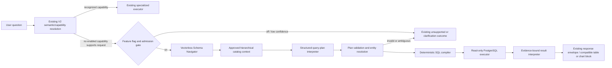
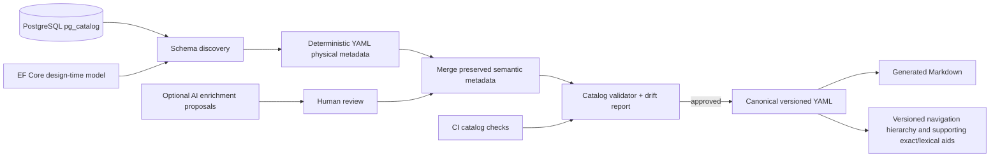

# Feature 141 — Design

## Mandatory architecture invariant

This design implements the Feature 141 objective in `spec.md`: answer diverse, previously unseen financial and capital-market questions through the YAML Semantic Catalog, a custom Vectorless Schema Navigator, a deterministic validated read-only query engine, and evidence-backed response generation. Adding an approved dataset must not require a question-specific handler, capability, intent, route, or SQL template. Existing capabilities and response/chart contracts, provider provenance, units, period semantics, and financial correctness remain protected. Semantic approval never grants query authorization. Initial coverage and disabled runtime are delivery gates, not limits on the target architecture.

## 1. Verified repository baseline

This section records source-confirmed behavior at specification time; proposed components below are not yet present.

### AI ingress and routing

- Public AI ingress is the existing `POST /api/ai/v1/query` facade, handled by `src/backend/FinancialCopilot.API/Controllers/AiFacadeController.cs` and the Application AI orchestration contracts.
- `IAiQueryOrchestrationService` is implemented by `MicrosoftAgentFrameworkAiQueryOrchestrationService` in Infrastructure. It dispatches to native `FinancialCopilotWorkflowDefinition` when `AiOrchestrationOptions.Mode` is `MicrosoftAgentFrameworkV2`, with the existing runner path retained for configuration rollback.
- `FinancialCopilotWorkflowDefinition.ExecuteAgentStepAsync` first executes a supplied governed `SemanticFrame` through `semanticExecutionCoordinator.ExecuteAsync`. It maps typed existing capability payloads into `AgentExecutedMessage` and response blocks. Requests without that frame can take legacy deterministic branches or the MAF tool loop. Existing outcomes include completed/no-data/unsupported/clarification/disambiguation semantics.
- MAF packages are constrained to Infrastructure by architecture tests. Any new model work should use the existing provider-neutral model contracts and keep framework-specific APIs in Infrastructure.
- Existing semantic dialogue specs 117–123 establish governed capability/frame/resolution boundaries and prohibit LLM-created executable metrics, formulas, entities, routes, or capabilities. Feature 141 composes with those specs; it does not replace them.
- `MonthlyActivityTrendIntentRules` is still a phrase/token-based legacy path. The typed trend path is `IMonthlyActivityTrendQueryUseCase` → Infrastructure `MonthlyActivityTrendQueryUseCase`, which calls `ICompanyResolverService` and `ICompanyMonthlyActivityTrendSnapshotRepository` and returns `MonthlyActivityTrendResponse` with chart points, Persian labels, units, source provider, and calculation time.
- A separate workflow method builds trend text (`BuildMonthlyActivityTrendContent`); persisted assistant payloads and frontend block mapping/rendering already support the existing monthly chart content. This is an established response contract to preserve.
- Company resolution is currently `CompanyResolverService` backed by `FinancialIngestionDbContext.Companies`: it normalizes and checks ticker, TSE symbol, English ticker/ISIN identifiers, instrument code, company symbol/name, then an unambiguous name fragment; unresolved/ambiguous fragment resolution returns null. It is reusable for company identity but is not a general product dictionary or typed ambiguity interface.

### Verified normalized persistence surface

`src/backend/FinancialCopilot.Infrastructure/Financial/Ingestion/Persistence/FinancialIngestionDbContext.cs` exposes, among other sets:

- `Companies`, `Industries`, `IndustryGroups`, `Markets`;
- `FinancialStatements`, `FinancialStatementLineItems`;
- `MonthlyReports`, `MonthlyReportLineItems`;
- `CompanyProductRevenueMix`, `CompanyMonthlyActivityTrendSnapshots`;
- market quote/trade/index persistence and other operational/notification tables.

The context is broad; a DbSet being present does not authorize generic query access. Monthly report line items have provider/report semantics and product fields; existing feature 129 and 136 specifications govern key source filters, product identity, period, and data quality. The company trend response reads persisted `CompanyMonthlyActivityTrendSnapshots`; README documents that production/sales trend answers must not reaggregate raw provider line items at response time. The known monetary conversion for that specialized path is performed by its use case. Generic query definitions must reuse the published trend snapshot where applicable or explicitly establish a new governed read model; they must not shadow specialized rules.

### Existing semantic and calculation assets

- `PhaseOneFinancialSemanticCatalog` in Domain contains metric definitions/aliases/policies for the existing financial semantic layer. Feature 015 remains the authority for financial metric formulas, aliases, units, and policy. The new database catalog references metric IDs and source bindings; it must not copy or override metric formulas.
- Existing company/product resolution and monthly production/sales capabilities are specialized, with tests and response contracts. Feature 141 cannot use a generic join to bypass their accepted-report, identity, unit, source, or revision logic.
- Existing feature flags/configuration conventions are options-based; the MAF V2 selection is configuration-controlled. No existing feature-flag service for this new engine has been verified. Use narrowly named options/config flags consistent with the existing options pattern; do not claim an existing flag framework.

## 2. Decision summary

| Decision | Selection | Reason |
|---|---|---|
| Primary schema retrieval | Custom Vectorless Schema Navigator over a generated hierarchy of approved YAML catalog nodes | LLM reasoning selects branches and requests bounded expansions; deterministic metadata traversal supplies actual objects and relationships. No external RAG framework or embeddings required. |
| Supporting search | Exact IDs, canonical symbol/entity resolution, alias maps, and lightweight lexical filtering | Fast deterministic shortcuts narrow candidate branches; they do not replace semantic navigation. |
| Vector store / PageIndex | Neither in production | No demonstrated requirement; avoids added infrastructure and an external framework. Offline embeddings may be used only as an evaluation comparator under a separate decision. |
| Catalog physical discovery | EF Core `IModel` plus PostgreSQL `pg_catalog`/`information_schema`, with the PostgreSQL catalog authoritative for deployed physical facts | EF metadata is deterministic/offline-friendly and expresses mappings; PostgreSQL reveals deployed views, indexes, constraints, actual schema drift and provider details. Neither alone is sufficient. |
| Query generation | Structured plan → allowlisted deterministic SQL compiler | Auditable identifiers, joins, parameters, and resource limits. Constrained LLM SQL still leaves parsing/validation risks and couples prompt to DB syntax. |
| Catalog source of truth | Version-controlled YAML | Reviewable diffs and stable deployment artifact; Markdown generated from it. |
| AI enrichment | Optional suggestion producer, never runtime authority | Keeps model uncertainty separate from schema facts and human approval. |
| Value dictionaries | Bounded approved-source discovery plus human-reviewed canonical identities, aliases, and broader classifications | Schema discovery does not establish real product values. Company-scoped product identity is distinct from cross-company category. |
| Integration | Fallback after established route resolution; failure does not fallback | Prevents an execution failure from changing semantics or bypassing specialized policy. |
| Runtime query scope | Only `approved` catalog surfaces and fields; views/read models preferred | Existing context also contains operational, billing-adjacent, alert, and user-scoped data that must not be generically exposed. |

### ADR 141-A — Custom Vectorless Schema Navigation over Canonical YAML Catalog

**Status:** Proposed and selected for the initial implementation.

**Decision.** Use a custom LLM-powered Schema Navigator over a compact hierarchy generated from the approved YAML Semantic Catalog. Use exact matching, existing symbol/entity resolution, reviewed aliases, and lightweight lexical filters only as supporting deterministic optimizations. Do not add PageIndex, another external Vectorless RAG framework, embeddings, pgvector, or a vector database to production.

**Rationale.** The catalog is governed structured metadata rather than an unbounded document corpus. Its known initial surface is intentionally curated and its actual future scale has not been measured. Hierarchical reasoning can select across business domains and request child context without shipping the entire physical schema. Deterministic expansion then supplies actual fields, metric policies, and allowed relationship paths. YAML and generated navigation artifacts are versioned and reviewable. No evidence currently demonstrates that a vector index would improve this workload enough to justify model/index infrastructure.

**PageIndex decision.** PageIndex is not used because the repository has no document-page indexing requirement and the feature's retrieval source is structured YAML plus known relationships. An external framework would add dependency and operational behavior without demonstrated benefit.

**Completeness and safety.** The LLM selects approved node IDs only. Application verifies every ID and checks completeness for required measures, dimensions, entity bindings, period semantics, source policy, and joins. It may perform bounded refinement; then a typed unsupported/clarification result is returned if incomplete. Approved relationship expansion and SQL compilation stay deterministic and independent of model output.

**Trade-offs and failure modes.** Compared with lexical-first retrieval, Vectorless navigation can understand indirect business language and compose multiple domains but adds LLM latency/cost, output variance, prompt-injection exposure, and risk of selecting the wrong branch. Mitigations: compact reviewed hierarchy, structured output, top-level ID validation, bounded calls/tokens/depth, independent completeness checks, evidence, golden evaluation, deterministic shortcuts, strict timeout/fail-closed behavior, and no query execution for incomplete plans. Compared with embeddings, it avoids embedding generation, vector infra, and semantic-index staleness but relies on provider reasoning and prompt quality. Costs vary by configured model and must be measured; simple requests target one navigation call, complex ones are capped at three plus a plan call unless combined safely.

**Revisit when.** Revisit only after versioned golden evaluations show persistent context-recall failure or unacceptable latency/cost at measured catalog size, despite improving hierarchy, descriptions, normalization, and prompts. An offline embedding baseline may inform that decision. Any production embedding or third-party navigator proposal requires a separate ADR and threat/cost review. This ADR makes no claim that Vectorless RAG is universally more accurate.

## 3. Target architecture



Catalog lifecycle:



## 4. Proposed component boundaries and contracts

The names below are proposed interface names, not verified existing types. Place application contracts in `FinancialCopilot.Application`; EF/Npgsql, YAML, provider, and file system adapters in `FinancialCopilot.Infrastructure`; do not put provider or ORM types in Domain/Application contracts.

### 4.1 Catalog tooling and lifecycle

Proposed tooling project/entry point: extend the existing backend tooling/CLI host if one is present; otherwise add a small `FinancialCopilot.CatalogTool` executable referencing Infrastructure for design-time EF metadata. Verify the current solution tooling projects before implementation. Runtime API must not own write permissions to the canonical catalog.

Proposed commands:

```text
dotnet run --project src/backend/FinancialCopilot.CatalogTool -- catalog discover --source ef|postgres|hybrid --output specs/141-schema-aware-semantic-query-engine/SemanticCatalog/generated
dotnet run --project src/backend/FinancialCopilot.CatalogTool -- catalog sync --source hybrid --catalog specs/141-schema-aware-semantic-query-engine/SemanticCatalog --report artifacts/catalog-drift.json
dotnet run --project src/backend/FinancialCopilot.CatalogTool -- catalog enrich --catalog specs/141-schema-aware-semantic-query-engine/SemanticCatalog --provider configured --dry-run
dotnet run --project src/backend/FinancialCopilot.CatalogTool -- catalog values discover --catalog specs/141-schema-aware-semantic-query-engine/SemanticCatalog --source-policy approved-only
dotnet run --project src/backend/FinancialCopilot.CatalogTool -- catalog values sync --catalog specs/141-schema-aware-semantic-query-engine/SemanticCatalog --report artifacts/value-dictionary-review.json
dotnet run --project src/backend/FinancialCopilot.CatalogTool -- catalog validate --catalog specs/141-schema-aware-semantic-query-engine/SemanticCatalog --schema-snapshot artifacts/postgres-schema.json
dotnet run --project src/backend/FinancialCopilot.CatalogTool -- catalog docs --catalog specs/141-schema-aware-semantic-query-engine/SemanticCatalog --output docs/semantic-catalog
dotnet run --project src/backend/FinancialCopilot.CatalogTool -- catalog hierarchy build --catalog specs/141-schema-aware-semantic-query-engine/SemanticCatalog --output artifacts/semantic-hierarchy
```

Names/options are proposed; existing CLI conventions must be confirmed in implementation. Commands must support nonzero exit codes on validation failures and deterministic output. `discover` and `sync` never delete reviewed metadata. `enrich` and `values discover` emit unapproved proposals only. `docs` and `hierarchy build` are reproducible generated artifacts.

`ICatalogSchemaDiscovery` returns `PhysicalSchemaSnapshot` with schemas, tables/views/materialized views where discovered, columns/types/nullability/defaults, PK/FK, indexes, constraints, and provenance (`EfModel`, `PostgreSqlCatalog`, `Both`). `ICatalogSynchronizer` performs stable-ID merge; `ICatalogValidator` returns typed errors/warnings/breaking changes; `ICatalogDocumentationGenerator` renders Markdown from canonical YAML; `ICatalogNavigationHierarchyBuilder` builds immutable hash-versioned navigation nodes plus optional exact/lexical lookup aids. Exact framework types belong in Infrastructure.

#### Discovery source choice

- EF Core `IModel` (from the same `FinancialIngestionDbContext` and other DbContexts found in the solution) supplies entity-to-table/schema mappings, property-to-column mappings, provider-neutral types, configured keys/relationships, and offline generation. It does not prove deployed DDL, manually created views, actual indexes, or whether migrations have been applied.
- PostgreSQL `pg_catalog`/`information_schema` is authoritative for deployed tables, views, column types/nullability, constraints, PK/FK, indexes, and schema state. Use catalog queries restricted to configured schemas. Avoid granting broad database read permissions to the CLI. It needs metadata visibility only and no table data access.
- Hybrid is recommended. EF produces a useful offline baseline; a live PostgreSQL pass compares the deployed instance and finds drift/non-EF objects. Data plane execution metadata is published only from reviewed output.
- Connection comes from existing configuration/secret providers (never checked-in credentials), with explicit `--connection-name` or environment selection. Generator validates TLS/config, logs server/database/schema identity but never credentials, and uses a metadata-only principal. If PostgreSQL is unavailable, `--source ef` remains usable but output declares `liveVerified: false`; CI/staging publication requires a schema snapshot or live check.

#### YAML layout and merge policy

Canonical package layout:

```text
SemanticCatalog/
  catalog.yaml                 # formatVersion, catalogVersion, generatedAt policy, schema hash, includes
  navigation.generated.yaml   # deterministic hierarchy from approved catalog metadata; never hand-edited
  tables/*.yaml                # physical facts + approved semantic descriptions/capabilities
  metrics/*.yaml               # catalog-local derived measures; references Feature 015 IDs when financial
  relationships/*.yaml         # approved FK-backed paths; non-FK paths require explicit review/evidence
  dictionaries/companies.yaml  # curated aliases reference canonical resolver IDs, not duplicated identities
  dictionaries/products.yaml   # company-scoped product alias/reference metadata only after identity review
  dimensions/*.yaml            # approved dimensions and safe grouping values
  manifest.yaml                # source provenance, hashes, reviewer/action log refs
```

Each entry has stable IDs based on normalized physical identity, e.g. `pg.financial.companies.column.ticker` and `pg.financial.monthly_report_line_items`; IDs survive descriptions and file renames. Renames require explicit `replaces` mapping. Physical fields are stored under `physical` and regenerated. Semantic values live separately under `semantic`, with `status: suggested|reviewed|approved|rejected`, `source`, `reviewedBy`, and `reviewedAt`. Merge rule: preserve human-approved semantic sections and comments/metadata by ID; update only physical facts; mark missing objects `obsolete` and emit drift; never silently erase or auto-approve. Generated files should be split so code generation does not rewrite hand-edited semantic blocks.

#### Hierarchical navigation catalog

The hierarchy is a deterministic logical view generated from approved YAML objects, metrics, relationships, dictionaries, and query policies. It is a navigation aid, not a substitute for PostgreSQL's relational graph. A node has stable ID, bilingual title/description, relevant concepts/synonyms, child node IDs, referenced catalog object/metric/dimension/relationship IDs, and catalog hash. A tree can have cross-domain references (for example, Production → Companies dimension) without duplicating the canonical definition. An object may appear in several branches by reference, but its canonical metadata is stored once.

Illustrative logical roots (not verified database domains):

```text
catalog
├── production-sales
│   ├── monthly-reports
│   ├── product-production
│   ├── product-sales
│   └── production-metrics
├── financial-statements
│   ├── income-statements
│   ├── balance-sheets
│   ├── cash-flows
│   └── governed-financial-metrics
├── market-data
│   ├── securities
│   ├── prices
│   ├── trading-activity
│   └── market-metrics
└── shared-dimensions
    ├── companies
    ├── industries
    ├── products-and-categories
    └── reporting-periods
```

The `navigation` section is generated from canonical approved semantics or emitted as a generated artifact keyed by canonical IDs. Human review may curate node descriptions/classifications in YAML, but generated child/object references cannot be maintained as a second source of truth. Validation checks every reference, unique/stable ID, reachability, cycles, and expected coverage. Version/hash follows the catalog manifest; immutable node summaries may be cached by catalog hash and node ID. Schema changes, approved semantic changes, or dictionary changes build a new hierarchy and invalidate old caches atomically. Runtime pins one version per request.

#### Data value discovery and dictionary governance

Schema discovery identifies structures; value discovery identifies actual values stored in approved sources. They use separate credentials and workflows. The schema generator uses metadata-only PostgreSQL permissions. Value discovery runs in a bounded offline/administrative job or controlled ingestion-side projection against explicit approved source/read-model fields, with schema version, row/result limits, source coverage, normalization version, and provenance. Runtime agent cannot browse arbitrary values or enumerate unrestricted tables.

Product dictionary entries separate:

- `productIdentityId`: source-backed, company-scoped identity (canonical company ID plus provider/product key or reviewed stable identity evidence);
- observed labels/codes/units and source/report provenance;
- reviewed aliases, normalized Persian/English forms, validity range, status, reviewer and version;
- optional `productCategoryId`: broader cross-company class, never inferred solely from similar names;
- equivalence evidence and confidence state, with ambiguous candidate groups awaiting review.

Discovery extracts distinct product identifiers and labels only from approved data paths, including normalized monthly-report line items when Features 129/136 permit that source/use. It proposes normalization, aliases, and possible categories; it does not merge identities, assert equivalent units, or rewrite historical IDs. Human review approves, rejects, or splits proposals. Ingestion can emit bounded change candidates for newly seen values; scheduled/manual sync recomputes source coverage and marks stale/retired values without deleting historical identity. Dictionary version is included in the catalog hash and query evidence. Cross-company category membership is assigned only through human-reviewed classification with evidence and effective dates.

Example structure (no physical names or values asserted):

```yaml
productIdentities:
  - id: product.identity.<stable-id>
    companyId: company.<canonical-id>
    sourceEvidence:
      provider: <verified-provider>
      sourceProductKey: <observed-key>
      firstSeenPeriod: <period>
    labels: [{value: <observed-label>, language: fa, status: observed}]
    aliases: [] # only reviewed aliases become resolver candidates
    categoryRef: null # set only by reviewed classification
    status: observed-unreviewed
```

Example (illustrative structure; actual names/types/keys must come from a generated schema snapshot, not this example):

```yaml
formatVersion: 1
catalogVersion: 1.0.0
objects:
  - id: pg.financial.monthly_report_line_items
    physical:
      source: postgres
      schema: financial
      name: MonthlyReportLineItems
      kind: table
      columns:
        - id: pg.financial.monthly_report_line_items.sales_amount
          name: SalesAmount
          type: numeric
          nullable: true
          primaryKey: false
          foreignKeys: []
    semantic:
      status: approved
      description:
        fa: "مبلغ فروش گزارش‌شده برای ردیف محصول؛ واحد و معنای گزارش باید از سیاست منبع تأیید شود."
        en: "Reported sales amount for a product line; source-specific unit policy applies."
      aliases: []
      queryPolicy:
        selectable: false # becomes true only after source filters/unit policy are explicitly approved
```

No example physical metadata above asserts that the given schema-qualified name or exact database type exists. A real generated file must match PostgreSQL and EF mappings.

#### Optional AI enrichment and review

Enrichment reads only discovered identifiers, types, approved relationship candidates, and existing trusted descriptions. It produces JSON proposals before YAML merge. Proposal fields include target stable ID, Persian/English draft, source catalog hash, model/provider, timestamp, confidence, and prompt version. Proposals can suggest terminology and likely meanings, but are quarantined as `suggested/unverified`. Reject output that mentions nonexistent fields/relationships or formulas. A human reviewer accepts/rejects in a review diff; an approval record identifies the reviewer and catalog version. No enrichment result is indexed as executable/search authority until approval. The feature may ship with no LLM enrichment if provider support/cost cannot be safely configured.

#### Markdown generation

`docs` reads YAML only, produces predictable table/field pages plus index pages for metrics, relationships, dictionaries, sample questions, and supported operations. Every generated document includes catalog version/hash and “generated; edit YAML” notice. CI regenerates to a temporary directory and fails on diff. Markdown is not loaded by runtime or fed as a competing source of truth.

#### Synchronization, drift and validation

Sync compares stable IDs and physical signatures. Added objects are `discovered/unapproved`; removed or changed object/column/type/nullability/constraint is a drift event; destructive or relationship-breaking changes block publication. Human-approved semantic text is preserved while attached physical facts update. Stale references, obsolete fields, formula dependency changes, duplicate aliases, missing descriptions on queryable elements, non-FK joins, navigation/hierarchy hash mismatch, and stale caches are reported. Schema expansion is not automatically executable.

Catalog validation layers:

1. YAML parse + JSON Schema (or equivalent typed schema) with duplicate-key rejection.
2. Stable ID uniqueness and semantic status/provenance rules.
3. Exact physical object/column/constraint match against EF and provided PostgreSQL snapshot; target-environment live check is a release gate.
4. PK/FK and relationship cardinality/path validation; query join graph must have one approved unambiguous path or require a named join path.
5. Metric dependency existence, cycle detection, data type, null behavior, unit compatibility, aggregation rule, and formula governance. Financial formulas point to Feature 015 or approved deterministic calculator contracts.
6. Alias uniqueness after Persian/Arabic normalization, collision review, and company-scoped product alias restrictions.
7. Policy check: no prohibited schemas/tables/columns, queryable metadata is approved, row-level/tenant policy assigned, and only supported aggregations/output shapes enabled.
8. Generated docs/hierarchy/supporting-lookup reproducibility and catalog hash/version consistency.

### 4.2 Vectorless Schema Navigator

Proposed Application-facing contract (exact names/types are implementation choices):

```csharp
public interface IVectorlessSchemaNavigator
{
    Task<SchemaNavigationResult> NavigateAsync(
        SchemaNavigationRequest request, CancellationToken cancellationToken);
}
```

`SchemaNavigationRequest` carries the user question, reply language, relevant route-admission result, pinned catalog version/hash, resolved exact entities/aliases when available, and bounded context. It does not contain database row data. `SchemaNavigationResult` contains selected hierarchy node IDs, approved catalog object/metric/dimension/relationship/read-model IDs, required entity-resolution requests, completeness status, missing requirements, bounded diagnostics, navigation call count/token usage, and catalog version/hash. It cannot contain SQL or arbitrary formula text.

Navigation algorithm:

1. **Understand.** A structured model call identifies likely business domains, concepts/metrics, entity/product mentions, dimensions, period/comparison, aggregation/ranking, and presentation intent. It does not generate executable SQL. Known tickers and reviewed aliases may be resolved deterministically alongside this call.
2. **Choose branches.** Give the model a compact bilingual root/domain outline containing only approved nodes. It selects relevant node IDs and may request child-node summaries. A simple case can return selected branches and initial completeness requirements in one call. Multi-domain questions may select multiple roots.
3. **Expand deterministically.** Application loads selected child summaries and exact catalog records, then expands only approved relationships and dimensions needed by the proposed operation. Expansion uses stable IDs; graph traversal is bounded by configured depth/fan-out and never searches arbitrary tables.
4. **Check completeness.** Deterministic completeness validation checks that all required measures, dimensions, entity bindings, period rules, source policies, and join paths exist in retrieved context. If incomplete, one additional bounded navigation/selection round may request known child IDs; validate again. Unknown IDs are rejected, not resolved approximately.
5. **Return context.** Return a versioned navigation result. Missing concepts/schema/relationships yield typed `CatalogNoMatch`, `InsufficientSchemaContext`, `UnsupportedOperation`, or clarification. A planner may produce the final structured Query Plan in the same call for simple queries only if it references selected nodes and passes identical independent validation; otherwise planning follows completed navigation.

`IVectorlessSchemaNavigator` owns interpretation and hierarchical branch selection only. It is not a SQL executor, entity authority, catalog author, or financial calculator. Supporting services are `ICatalogHierarchyProvider` (immutable cached nodes), `ICatalogContextExpander` (deterministic approved-object/relationship expansion), and `ISchemaContextCompletenessValidator` (required-slot coverage). Exact entity resolvers remain separate. A light exact-alias/lexical prefilter may reduce outline size, but the semantic decision comes from LLM navigation over the hierarchy.

#### Call, token, latency, and cache policy

- Target one navigation LLM call for a simple one-domain question. A complex multi-domain or incomplete context may use up to three navigation calls total (initial selection plus at most two refinement rounds); final query-plan interpretation counts separately unless safely combined with the final navigation output.
- Keep the root outline compact and cache immutable summaries by `(catalogHash, nodeId, language)`; never cache authorization decisions.
- A validated navigation result may be cached only by normalized question signature plus catalog hash, normalization/prompt/schema versions, and only before entity/tenant authorization. On cache hit, revalidate IDs, entity resolution, capability admission, policy, and tenant access. Do not share user-specific results or authorization across security boundaries.
- Set per-call input/output token limits, maximum hierarchy depth (initial proposal: 3), expansion fan-out, total context budget, request call cap, and total timeout. The model can request only node IDs disclosed in its current context. Stop and return incomplete-context outcome if a limit is reached.
- Telemetry records calls, input/output tokens, estimated provider cost, navigation latency, depth, node IDs, cache status, and failure reason. Cost estimates use configured provider pricing metadata; no fixed currency amount is assumed.
- Catalog hash change, approval change, hierarchy generator version, prompt/schema version, Persian normalization version, or dictionary version invalidates affected summaries/results. Version mismatch fails closed for generic fallback.

No PageIndex, embedding model, vector database, pgvector extension, external RAG framework, or remote retrieval service is required or selected. Offline embedding evaluation is optional and cannot affect runtime or become a dependency without a separate ADR.

### 4.3 Structured interpretation and Query Plan

The query agent receives the user message, language/context policy, enabled capability outcomes, and only the retrieved catalog records. It returns a versioned JSON document. Application validates JSON Schema and catalog references before any resolution or execution.

Illustrative plan (all IDs must resolve to approved catalog entries):

```json
{
  "schemaVersion": 1,
  "operation": "compare_trend",
  "entities": [{"kind": "company", "text": "کگل"}],
  "measures": [{"id": "metric.monthly_production_quantity", "aggregation": "sum"}],
  "dimensions": [{"id": "dimension.report_month"}],
  "period": {"kind": "rolling_months", "count": 3, "calendar": "jalali"},
  "filters": [],
  "groupBy": ["dimension.report_month"],
  "comparisons": [{"kind": "company", "entityText": "کگهر"}],
  "sort": [{"target": "measure:0", "direction": "asc"}],
  "limit": 100,
  "presentation": {"kind": "chart", "chartType": "line"},
  "clarification": null
}
```

This is not a fixed intent enum for each question. `operation` is a small algebra of `select`, `aggregate`, `compare`, `trend`, `rank`, `distribution`; dimensions/measures/filters compose. The actual supported algebra and period grammar are defined in the catalog/schema version. The parser cannot name arbitrary SQL functions, joins, columns, expressions, or metric formulas. Unsupported calculations map to a typed outcome.

The plan includes resolved and unresolved natural-language mentions but does not trust LLM entity IDs until canonical resolver confirmation. Typed clarification includes `MissingEntity`, `AmbiguousEntity`, `MissingPeriod`, `AmbiguousMetric`, `UnsupportedOperation`, `CatalogNoMatch`, and `InsufficientDataSemantics`.

### 4.4 Entity resolution

- Companies: adapt the existing `ICompanyResolverService` / `CompanyResolverService` for known resolution semantics. Prefer a follow-on extension from Feature 119's typed canonical outcomes; if that is not yet implemented, wrap existing null/resolved outcomes and preserve ambiguity rather than guessing. Do not duplicate the Companies dictionary in YAML; catalog aliases map to canonical company IDs and are reconciled against the resolver.
- Products: use reviewed, company-scoped product IDs/aliases only where the repository's normalized source identity and product-specific specifications support it. Reuse feature 129/136 product normalization/resolution policy; do not ask the LLM to fuzzy-match products or equate same-title products across companies.
- Industries, periods, and other entities: define approved dictionary/dimension resolution with typed `Resolved`, `NotFound`, `Ambiguous` results. Include canonical ID and evidence.
- Resolve before compilation. A required unresolved entity blocks execution; no broad fallback query scans tables to guess.

### 4.5 Query algebra and financial semantics

The versioned algebra composes a bounded set of operations instead of adding an intent per wording. Candidate v1 operations are `select`, `filter`, `aggregate`, `group`, `rank`, `time_series`, and `compare_periods`/`compare_entities`. The plan may request dimensions, but every combination is permitted only when the catalog declares it safe.

| Question operation | V1 support policy |
|---|---|
| Selection/filtering | Allow approved fields and typed operators only; list-valued filters use governed dictionaries. |
| Aggregation/grouping | Count/sum/min/max and approved average over explicitly aggregatable metrics; dimensions must be approved and group cardinality bounded. |
| Ranking | Deterministic sort with stable ID tie-break; explicit/default limit is capped. |
| MoM/YoY/time series | Require metric period/calendar, baseline, missing-period, null/zero and unit policies. No calendar interpolation. |
| Growth/percentages/ratios | Reference Feature 015 metric or reviewed deterministic calculation definition. Never use a prompt-provided formula. |
| Product contribution/revenue mix | Use existing specialized capability where recognized. Generic path only after a reviewed source/read model and deterministic contribution policy are catalog-approved. |
| Industry benchmark | Requires verified company-industry relationship, effective-date policy and approved benchmark aggregation. Missing industry context prompts clarification. |
| Consecutive-period growth | Requires an explicit consecutive-calendar policy and missing-period behavior; a gap is not silently treated as consecutive. |
| Multi-dimensional analysis | Permit only bounded approved combinations with fan-out/cardinality checks. Otherwise reject/clarify. |
| Forecast, valuation, inferred inventory, arbitrary statistics/formulas | Unsupported in generic algebra; defer to existing specialized deterministic engines or a separately governed feature. |

Query plan schema, catalog metric definitions, and compiler operator support must share a version. Adding an operator requires validation, fixtures, evaluation and a versioned migration; the LLM cannot expand the algebra.

### 4.6 Plan validation, planning and deterministic SQL

Proposed pipeline:

1. Check active feature flag and admission result; attach catalog hash and capability resolution trace.
2. Retrieve catalog; parse schema-constrained JSON output.
3. Resolve canonical entity references and normalize Jalali/Gregorian period selection under catalog policy.
4. Validate measures/dimensions, source-specific filters, compatible units, null/negative behavior, aggregate support, comparison semantics, tenant restrictions, and requested presentation.
5. Build a relational logical plan from approved IDs. Every join edge names catalog relationship ID and cardinality. Reject ambiguous paths/cycles and fan-out hazards unless an approved aggregate-safe path exists.
6. Compile allowlisted identifiers and fixed operators to parameterized Npgsql SQL. Only `SELECT` / read-only CTEs are produced. No SQL text from the LLM is accepted.
7. Run defense-in-depth SQL policy validation on the generated statement and parameter metadata; set local transaction `READ ONLY`, statement timeout, and resource policy.
8. Execute on a dedicated database principal with SELECT only on approved schema objects (or approved views). Apply parameterized tenant/actor filters where objects are scoped.
9. Bound results before model interpretation; attach row count, truncation marker, units, period, source fields, source timestamps, catalog/metric versions, and query fingerprint.
10. The response generator summarizes only returned evidence. It cannot fill nulls, extrapolate, calculate new financial formulas, or make investment recommendations.

Proposed initial hard limits (configurable and measured): 5 joins, 12 selected/group fields, 12-month range for default ad-hoc trends unless catalog metric policy permits wider, 500 rows returned, 1000 pre-aggregation rows or use server-side aggregate plan, 2-second database statement timeout, 3-second execution budget. Choose limits against real query plans in staging. User-requested limits can only tighten caps. Query timeout/resource exhaustion returns typed `QueryLimitExceeded` / `ExecutionTimeout` and is not retried through another capability.

#### SQL compiler vs constrained LLM SQL

Deterministic compiler is the choice. It makes identifier provenance, relationship selection, formulas, parameters and plan tests inspectable. It costs more initial implementation and requires a finite algebra/catalog; that is appropriate for financial data. Constrained LLM-generated SQL is rejected as the initial approach because syntax validation does not prove semantic correctness, safe joins, metric/unit policy, tenant constraints, or absence of costly query shapes. A future SQL model may be considered only as a private proposal format compiled back into the same typed algebra, never executable SQL.

### 4.7 Result interpretation, provenance and response integration

Return a typed `SemanticQueryResult` in the existing `AgentExecutedMessage` / result-computation pipeline. Proposed `GenericDataQueryResult` fields: outcome/status/reason, columns (catalog ID, display label, type, unit), rows (typed/null values), requested/actual period, evidence references, truncation, catalog hash, query fingerprint, elapsed time, and optional chart spec.

Reuse current `AiQueryResponse`, `AiFacadeController`, conversation persistence, and frontend `AssistantBlock` mapping when an existing structure can express the result. Existing monthly trend responses and `monthlyActivityTrendChart` payload discriminator remain untouched. For generic tables, add a new versioned structured content discriminator only after auditing persisted-message deserialization and web/Telegram renderers. A chart uses the existing renderer only when its point/series structure matches an established contract; otherwise ship tabular response first and defer generic charts. Keep existing chart generation for legacy monthly sales/price/financial chart questions routed to their established capability.

#### Future-compatible Generic Chart Contract

Chart specifications are constructed deterministically from typed query results and catalog presentation metadata; the model may request `line`, `bar`, or `stacked_bar` only when supported, but cannot author arbitrary chart JSON, JavaScript, axes, or values. Proposed versioned contract:

```json
{
  "kind": "genericChart",
  "version": 1,
  "chartType": "line",
  "title": "<approved localized title>",
  "categoryField": "dimension.report_month",
  "series": [{"field": "metric.monthly_production_quantity", "label": "<catalog label>", "unit": "<catalog unit>"}],
  "points": [{"category": "<period-id>", "values": {"metric.monthly_production_quantity": 0}, "evidenceId": "<evidence-id>"}],
  "missingValuePolicy": "gap",
  "evidence": [{"id": "<evidence-id>", "catalogHash": "<hash>", "sourceRef": "<catalog-ref>"}]
}
```

The backend validates chart type, field references, units, point/series count, and evidence references against the typed result. The frontend renderer is bounded and escapes labels. If existing `monthlyActivityTrendChart` contract is a fit, use that route only through its existing specialized capability; the generic contract does not mutate or masquerade as the established discriminator. Initial generic release may return tables only until web, persisted-message, and Telegram compatibility is verified.

Evidence per cell/series includes source table/view and column or metric ID, aggregation/calculation, canonical entity IDs, period bounds, unit, source/provider timestamp when present, and null/truncation state. Do not expose internal SQL or secrets. Expose a stable query fingerprint for logs and support, not raw literals.

### 4.8 Routing and backward compatibility

- Existing semantic registry/interpreter/resolution handles recognized intents/capabilities first.
- Generic dynamic query is eligible only when the semantic/capability result is explicitly unsupported/unmatched and no legacy deterministic route recognizes it. Do not infer eligibility from an executor exception or no-data result.
- The workflow must preserve ordering. The new branch is explicit; ensure legacy raw-text branches and existing native semantic frames retain current priority and payload mapping.
- Specifically freeze behavior for `روند فروش کگل`, established financial comparisons, price/financial charts, comprehensive analysis queries, and existing product/monthly specializations. Golden tests must assert both executor and response payload.
- Initial flag off, shadow evaluation allowed only without execution or with explicitly bounded read-only fixture/canary; production result presentation requires catalog gate and explicit rollout.
- Separate flags: `SchemaAwareQuery:Enabled` (master), `SchemaAwareQuery:ShadowMode`, optional `SchemaAwareQuery:CanaryTenantIds`/percentage. On disable or unhealthy hierarchy/cache, new fallback closes and existing behavior remains. A recognized route never changes due to these flags.

### 4.9 Security, privacy and observability

- Dedicated PostgreSQL runtime role: CONNECT, USAGE to approved schemas, SELECT only on explicit approved views/tables; no writes, temp object creation, function execution, DDL, schema changes, catalog writes, or access to Identity/Billing/Conversation/Notification/private user tables by default. Revoke default PUBLIC grants where operationally possible.
- Catalog cannot grant access by itself. A separate security policy list constrains schemas, columns, tenant ownership and approved read views. Data classification and sensitive-field review are required before approval.
- Parameterize all data values. Quote identifiers using provider-safe identifier handling after allowlist resolution. Reject comments, multiple statements, unknown operators/functions, unbounded wildcard selection, and cross-tenant query plans.
- Prompt injection text is treated as user data; instructions embedded in descriptions/questions cannot alter policy. Retrieved catalog descriptions are reviewed content, not code.
- Limits: request size, retrieved tokens, JSON output tokens, query cardinality, rows, CPU, elapsed time, concurrency. Cancel database execution on request cancellation.
- Emit structured telemetry: outcome/reason, feature flag, capability admission path, catalog version/hash, retrieval IDs/rank, planner schema version, validation rejection code, compiler fingerprint, row count, timeout, token usage, model/provider, total latency, DB latency. Do not log full user financial query by default; existing redaction/privacy policy applies.
- Missing/invalid catalog, hierarchy/cache, DB connection, resolver, plan, compiler or executor produces controlled typed outcomes and telemetry. Infrastructure failure never triggers an alternative query path.

## 5. Feature flags and rollout

Defaults: `Enabled=false`; `ShadowMode=false`; no canary population. Catalog and catalog tooling may be deployed independently of the runtime query engine. Rollout: offline generation + CI → staging catalog validation → disabled production deployment → shadow interpretation/admission without data query → internal tenant canary read-only → allowlisted query canary → incremental tenant percentage. Rollback: turn `Enabled=false`, retain existing workflow/capability registrations, revert the hierarchy/catalog artifact to last validated hash, revoke runtime SELECT grants if necessary. No database migration is required for the first YAML-backed catalog; adding catalog persistence, pgvector, embeddings, or external RAG tooling is outside the selected initial architecture and would require a separate decision.

## 6. Catalog example documentation output

Generated `docs/semantic-catalog/tables/monthly-report-line-items.md` (actual path/name depends on generated schema):

```markdown
<!-- Generated from SemanticCatalog, version <hash>. Do not edit here. -->
# <approved Persian table label>

Physical object: `<schema>.<table>` · Discovery: EF + PostgreSQL · Catalog status: reviewed

| Field | PostgreSQL type | Nullable | Approved meaning | Query use |
|---|---|---:|---|---|
| `<field>` | `<type>` | yes/no | <human-approved text> | <select/filter/aggregate policy> |

## Approved relationships
<relationship id, cardinality, FK evidence, query policy>

## Metrics and examples
<metric definition IDs and approved Persian questions>
```

No live table/column examples should be committed until generated against verified schema and approved.

## 7. Unresolved decisions

1. Which PostgreSQL schema(s) and database environments are authoritative for generation (local, integration, staging, production)? Recommendation: non-production representative schema plus production drift read-check; never extract row data.
2. Which existing CLI host/tooling pattern should own commands? Verify solution before implementation.
3. Which persisted sources can legally and semantically answer cross-company product/industry questions? Data completeness and company/industry/product identity coverage require a Phase 0 inventory.
4. Can a safe query projection be built over existing tables, or are approved views needed for source-specific monthly data? Feature 129/136 constraints and Feature 076 snapshot policy must be reconciled by each semantic dataset.
5. Final p95, timeout, result-size, and token thresholds require staging benchmark results.
6. Generic structured-table payload schema and Telegram rendering must be decided after frontend persistence/rendering audit; do not add a new contract until fit is proven.

## 8. Curated catalog update (2026-10-08)

The Feature 141 candidate overlay contains 18 physical tables plus the Noavaran Fundamental Index endpoint record. The canonical catalog keeps physical PostgreSQL facts in generated `physical` metadata and reviewed meaning in `semantic` metadata. Semantic assertions carry provenance and review status so owner-confirmed definitions do not look like source-code or schema facts. `IsRepresented=true` means Restated with `business-owner-confirmed` provenance; `IsComposing` remains pending upstream semantic verification.

`TradingInstruments.Id`, provider-scoped/external instrument identities, `Companies.Id`, and provider-scoped company identities are distinct. Market observations join by their verified required `TradingInstrumentId` foreign keys; an optional `NormalizedCompanyId` foreign key is the only declared instrument-to-company relation. The current source-code resolver can be ambiguous because it matches `InstrumentCode` without filtering Company.ProviderName, so catalog consumers must preserve the link state and must not infer it from ticker/name.

All 18 tables retain `candidate-pending-review` and `queryable: false`. The CodalDb preference for represented/restated rows is documented as implemented behavior pending business approval; catalog maintenance does not change that or any runtime execution behavior.

## 9. Feature-level architecture guardrail

Feature 141's end state is catalog-driven generalization across approved financial and capital-market data. The navigator selects relevant catalog branches for a natural-language request; the planner composes a query from a versioned operation algebra; application code validates meanings, provenance, units, periods, joins, and policy; and a deterministic compiler executes parameterized, read-only SQL. Adding a dataset or reviewed calculation policy expands coverage through the catalog and algebra, not by adding a question-specific route, handler, intent, or SQL template. Evaluation prompts remain test data, never a runtime allowlist.

The initial 18-table candidate scope, disabled query execution, and unsupported outcomes are temporary delivery constraints. They do not redefine the target as a fixed-question or fixed-dataset system. Existing specialized capabilities retain first refusal and their calculation and response contracts. A slice is not complete if it advances initial coverage by introducing per-question dispatch or prevents later approved catalog branches from composing through the same generic engine. Acceptance must include held-out query shapes and at least one catalog-only coverage expansion with the generic navigation/planning/compiler path unchanged.


## Navigator implementation update (2026-10-08)

The application layer now provides `LlmVectorlessSchemaNavigator`, `JsonCatalogNavigationHierarchyProvider`, and explicit call/depth/context/output/timeout/fan-out/cost budgets. It uses the current structured-output model execution pipeline and its provider routing, usage accumulator, and telemetry sink. The requirement extractor and navigator have separate versioned contracts. Required independent fields must be echoed unchanged by the navigation proposal; an omission or alteration is rejected. Catalog metadata is loaded from the generated hierarchy and selected branches expand deterministically. Navigation metadata approval, semantic approval, and query authorization are surfaced separately.

Infrastructure registers the navigator and hierarchy provider for injection, with configurable budgets, but no workflow or API branch invokes it, so it is not active at runtime. The golden evaluation script consumes recorded JSONL predictions and supports external held-out JSON datasets; without real predictions its accuracy metrics remain unavailable. The hierarchy loader checks the artifact's version/hash against the request, but it does not yet recompute the canonical YAML package hash during load. The catalog package still requires governance review before any query authorization.

## Financial retrieval and source-item resolution

The navigator carries typed references without conflating a governed metric with a provider source item or provider-calculated indicator. `DirectSourceItem` resolution preserves `(ProviderName, StatementType, SourceItemId)` and the verified `FinancialStatementSourceItems.Id` UUID; a missing MetricCode does not invalidate the direct reference. For historical line items with null SourceItemCatalogId, resolution is unresolved. No migration/backfill is part of this feature.

Candidate ranking may use verified titles and aliases for navigation only. Unknown title/unit/mapping fields remain null or unknown. `N/A` is not a unit. Hierarchy outline generation returns a bounded, question-ranked candidate set; it does not turn the entire source dictionary into prompt context. Query authorization remains a separate deterministic gate.

Primary financial metrics are provider values. A missing provider value produces typed unavailable/unsupported status; application code never derives EPS, operating profit per share, margins, or valuation ratios as a fallback. Period comparison is admitted only after matching company, scope, provider, source item/metric, unit, and comparable periods. Negative-baseline growth is unsupported pending policy approval.

## Bounded navigator evaluation design (2026-10-08)

- Requirements extraction remains a separate structured model call and the completeness-validator source of truth. Navigation output carries only selected canonical node IDs, missing requirement codes, expansion IDs, and an outcome.
- Limits: four total calls per request (including extraction and retries), at most three navigation calls, one bounded retry, 700 initial output tokens, 1,200 retry output tokens, 4,200 total output tokens, 18,000 input tokens, 18,000 outline characters, 10,000 estimated catalog-context tokens, 36,000 prompt characters, depth two, fan-out 12, 20-second per-call timeout, and 45-second total timeout.
- Follow-up calls using `previous_response_id` reserve input tokens conservatively before dispatch, then add provider-reported usage. Estimated and provider-reported input/output usage remain separate. Optional cost ceilings apply when the provider reports cost; otherwise cost is reported as unavailable.
- Source-item retrieval uses Persian normalization and deterministic lexical ranking over the 296 definitions. It passes at most 12 compact candidates and prunes the lowest-ranked tail only as needed to fit, retaining at least four when available. An independently validated direct-source reference maps to its canonical node deterministically. No question-specific dispatch was added.
- High-fan-out expansion now returns the selected node plus a diagnostic rather than returning null. The independent completeness validator still reports missing required context, so this pruning cannot silently mark a request complete.
- Results distinguish retrieval completeness, semantic review approval, query authorization, and executability. A retrieved but unapproved context remains non-executable.
- Truncated Responses API output is surfaced as `ModelOutputTruncated` with response ID, completion reason, status, usage, and latency. Partial JSON is never accepted. Hard quota errors do not retry or switch providers.
- The CLI writes each case incrementally, continues after failures, never fabricates predictions, and reruns only failed rows (intersected with any explicit case filter). The scorer handles the catalog's structured `IsComposing` expectations and scores only recorded outputs.

## Requirement-guided deterministic hierarchy expansion (2026-10-08)

`SchemaContextExpansionRequest` now carries the independent canonical catalog references. The hierarchy provider resolves each to its most specific matching node and walks cataloged ancestors before bounded expansion. When child fan-out exceeds 12, children with required references rank first; if any such child exists, unrelated siblings are omitted from that expansion. The 48-node cap and diagnostics remain. Completeness is still evaluated against the independent requirements and reports omissions rather than treating partial expansion as complete. This reduced wasted sibling context while preserving the exact source-item 161 identity.

The request-wide 18,000-input-token budget retains a conservative continuation reservation. Prompt-only estimates were tested and produced actual requests over the cap, so that experiment was discarded. The final live run confirms all 21 Golden cases returned predictions without request-wide token failures under the existing limits.

Evaluation results and limitations are recorded in [quality-optimization-report-2026-10-08.md](evaluation/quality-optimization-report-2026-10-08.md). Held-out v4 is a final independent measurement and was not used for tuning.

### Final evaluation correction

The post-retry final Golden score is node recall 0.9160, metric recall 0.8462, dimension recall 0.9048, exact domain accuracy 0.0000, and source-item accuracy 0.7500. Held-out v5 recall is 0.6667. Although the provider-level expansion test enforces its 48-node bound, one final end-to-end Golden output contains 60 selected IDs. The output artifact exposes this as an unresolved integration defect; the 48-node limit is not considered verified end to end.

## SQL compilation and executor design (2026-10-08)

`StructuredQueryCompiler` consumes typed plan metadata and a read-only immutable `StructuredQueryCatalogSnapshot`. The plan contains no SQL. Physical schema/table/column names and the three required relationship bindings are resolved by catalog IDs and quoted after identifier validation; data values use named parameters. The initial supported SQL shape is a direct source-item latest-observation query over `FinancialStatementLineItems`, `FinancialStatementSourceItems`, `FinancialStatements`, and `Companies`. Company resolution must already be a stable UUID; a ticker/name is never used as a join key. Missing or inconsistent relationship metadata, unknown sources, catalog hash mismatch, incomplete plan, formula/comparison, or unsupported algebra is rejected.

`NpgsqlReadOnlyStructuredQueryExecutor` accepts only compiler-created queries and separately issued grants. It verifies explicit Development opt-in, matching tenant/database/role, source allowlisting and grant expiry; opens a read-committed transaction, sets it read-only, confirms server database/user/read-only state, applies command timeout/cancellation and bounded concurrency/rows/bytes, and returns typed no-data/ambiguity/truncation/failure outcomes with evidence columns and a query fingerprint. Deployment must provision the configured role with SELECT-only grants on only approved relations; application checks do not provision or replace database permissions. Options are unconfigured and disabled by default; no app default connection string is reused.

Statement rows are matched by company FK, provider, statement type, source-item catalog UUID, source item ID, and `IsComposing` (`false` standalone by default, `true` only for explicit consolidated scope). Latest reporting period is selected from eligible observations; all same-period variants retain audited/restated/revision identity. Scalar ties are returned as `Ambiguous`; neither sync timestamps nor statement IDs choose a winning variant.

### Unresolved mappings before canonical execution

The canonical catalog contains verified physical edges for `FinancialStatementLineItems.SourceItemCatalogId -> FinancialStatementSourceItems.Id` and `FinancialStatements.CompanyId -> Companies.Id`, plus a verified application-level `FinancialStatementLineItems.FinancialStatementId -> FinancialStatements.Id` relationship. The last relationship is explicitly marked as lacking a physical FK. Compilation requires all three catalog edges in the validated snapshot; the test fixture now uses their canonical IDs. A Development grant must independently list every source, relationship, and physical object. Snapshot and company-binding components exist, but no live database execution has occurred.

### Canonical relationship and snapshot follow-up (2026-10-08)

The canonical snapshot now describes the application-level `FinancialStatementLineItems.FinancialStatementId -> FinancialStatements.Id` join as `rel_2588cf95d01a651a`. It is not represented as a physical FK: the captured physical schema did not report one. The runtime snapshot builder consumes canonical catalog records and the generated hierarchy only after source-hash, hierarchy-hash, and manifest-lock validation. It preserves `runtimeJoinable=false`, `semantic.approved=false`, and query authorization false for this relationship and source item 161. The offline compiler fixture exercises the canonical metadata; it does not constitute live company resolution or PostgreSQL proof.
Feature 141 company binding now adapts the existing `ICanonicalQueryEntityResolver` result into a typed binding. It carries only `CanonicalId` into the plan and never turns `ExternalCompanyId` or `TradingInstruments.Id` into `Companies.Id`. `Companies` is a shared master-data surface without a tenant key; the binder requires a tenant context, while actual read authorization stays tenant-bound in the development grant.

## Option B Phase 1 — Canonical semantic intent (2026-10-10)

The owner-approved Option B order is Persian question → schema-independent `CanonicalSemanticIntent` → deterministic intent validation → vectorless catalog binding → semantic completeness → existing planner/compiler → separately authorized execution. The intent records business measures, operations, comparisons, reporting periods, company/population scope, product/category conditions, boolean and numeric filters, aggregation/ranking, output shape, provenance, and clarification needs. It contains no catalog IDs, provider IDs, company UUIDs, SQL, or physical schema names. `LlmCanonicalSemanticIntentExtractor` uses `IAiModelExecutionService` with structured output, a 25-second deadline, one bounded repair retry, output bounds, and sanitized diagnostics. The validator remains independent from catalog coverage and query authorization.

The implementation is an evaluation-only shadow seam. It is not registered into chat routing and does not perform catalog binding, planning, compilation, or execution. Population discovery is represented as `UnboundCompanyPopulation` with no company labels. Financial units and product equivalence remain semantic/governance metadata; no primary financial statement formula is introduced. See [ADR — canonical intent before catalog binding](evaluation/ADR-option-b-canonical-intent-2026-10-10.md).
# Owner-confirmed statement units and item-level tie resolution (2026-10-08)

- Ordinary monetary financial-statement items use `MillionIRR`; per-share monetary items use `IRRPerShare`. This versioned semantic policy is separate from raw provider `Unit`, so raw `N/A` remains visible while the effective unit carries owner-policy provenance.
- The source-item build applies deterministic reviewed title rules across the 296-record snapshot. Per-share titles are classified explicitly; quantity, rate, percentage, and similar nonmonetary titles remain `RequiresSemanticReview` with no effective unit. The generated dictionary remains non-queryable.
- Noavaran `IncomeStatement` item 161 is approved for direct persisted retrieval semantics, title, and `IRRPerShare` unit without a MetricCode. Its approval does not approve tables, columns, relationships, or SQL access.
- Scalar SQL now enumerates every statement in the selected latest reporting-period end and preserves rows with a missing requested item. The executor checks period start/type/scope before comparing exact persisted values. Equal values collapse to one value with all statement identities; different values are `Ambiguous`; a missing candidate observation is `Incomplete`. Periods and scopes remain distinct and audit/restatement/revision attributes are evidence, not precedence rules.
- Effective unit and provenance are carried from canonical catalog entry through the compiled query to result metadata. The physical `Unit` remains raw evidence.

## Monthly Slice C design update (2026-10-08)

Monthly comparisons are compiled from typed operation/scope fields. MoM and YoY use bounded `LAG` offsets, preserve each reported base observation, and do not fill missing months. Growth guards zero and unapproved negative baselines. Sums and top-N rankings require explicit governed measures, grouping, sort, and limit. Multi-company IDs are individually covered by the tenant/company execution grant; compatible quantity units are checked from returned evidence. SQL values remain parameters and object names come from the validated catalog. The CLI's live mode stops at Navigator because monthly catalog authorization is pending.
