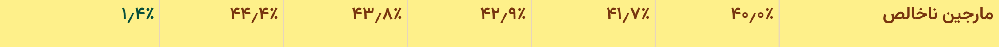

# Feature 144 — Quarterly Financial Table UI Refinement and PNG Export

## Cost-aware QoQ change colors

- Expense polarity is now based only on `SourceItemId` values 1, 5, 12, and 334. Since the frontend receives Markdown without row metadata, IDs are attached from Feature 144's fixed 16-row contract only when the complete ordered row set is present; partial tables remain unclassified.
- The shared pure color resolver is used by both the on-screen table and PNG canvas. Expense increases are red and decreases green; other rows keep positive green and negative red. Zero, opposite-sign, and unavailable comparisons use neutral colors.
- Displayed values and calculations are unchanged: the absolute-magnitude QoQ formula remains in place, output keeps one decimal and Persian digits, negative values are not parenthesized, opposite-sign rows stay blank, unavailable rows keep the dash, and share-count zero changes stay blank.
- The focused tests cover all approved expense IDs, expense/non-expense polarity, zero and unavailable states, opposite-sign and share-count special cases, original percentage values, and matching web/PNG semantic colors. The چخزر cases render Revenue +۲۷٫۵٪ green, cost of goods sold +۳۰٫۱٪ red, general/administrative expense +۱۱٫۱٪ red, and net profit +۴۵٫۹٪ green.

## Files changed

- `src/frontend/src/components/app/quarterly-financial-table.tsx`
- `src/frontend/src/components/app/quarterly-financial-table-colors.ts`
- `src/frontend/src/components/app/quarterly-financial-table-constants.ts`
- `src/frontend/src/components/app/quarterly-financial-table-image.ts`
- `src/frontend/src/components/app/__tests__/quarterly-financial-table-colors.test.ts`
- `src/frontend/src/components/app/__tests__/quarterly-financial-table.test.tsx`
- `src/frontend/src/components/app/__tests__/markdown-message.test.tsx`
- `src/frontend/src/components/app/__tests__/quarterly-financial-table-image.test.ts`
- `specs/144-quarterly-financial-reports-table/quarterly-table-ui-redesign-report.md`

The existing Markdown integration parses financial tables into the shared quarterly table component, so no separate formatting path was added.

## Table presentation and formatting

- Gross margin values are treated as percentage points already supplied by the report and rendered with one decimal place. The renderer adds only the Persian percent sign; it does not multiply the value again.
- Financial values, quarter and year labels, summary figures, row-label digits, percentages, and the export date use Persian digits. `Intl.NumberFormat` with the Persian numbering system supplies localized decimal and grouping separators.
- The header unit summary removes the redundant share-count unit while retaining monetary units and EPS units.
- Change values use the shared parsed model for both the table and PNG. Comparable nonzero values with the same sign use the absolute-value percentage formula; exact zero displays Persian zero without a percent sign. Share-count zero changes and sign mismatches are empty with a neutral white cell. Unavailable comparisons retain the existing dash.
- The header uses a restrained teal palette, coordinated with the beige label cells, yellow gross-margin highlight, and green/red change cells.
- PNG filenames include the symbol from the report title and a Persian-calendar date. Invalid filename characters and repeated separators are removed.

## PNG export consistency fixes

- The PNG exporter painted a header row, but rebuilt the header labels independently from the web table. That separate list could drift. The change-column title is now defined once in `quarterly-financial-table-constants.ts` and used by both renderers; the canvas test verifies it is drawn.
- The exported change-column header used a white fill while the web table uses teal (`#c7e5e1`). The PNG now uses the same fill. Header alignment follows the on-screen table: the description is right aligned and quarter/change headers are centered. RTL column order keeps `شرح` on the right and the change column on the left.
- Canvas change-value parsing did not normalize directional marks, Unicode minus signs, or the Persian percent sign. Negative percentages could therefore be treated as neutral. Parsing now handles those characters so the PNG keeps the same positive/negative background and text colors as the web table.
- The change-column title is now **درصد تغییر به فصل قبل** in the on-screen header and the exported PNG.
- Financial calculations, row order, and data semantics were not changed.

## Verification

- Ran the focused quarterly table and Markdown suite from `src/frontend`: **38 tests passed across 4 files**. It covers all approved expense IDs, positive/negative polarity for expense and other rows, zero/unavailable/opposite-sign/share-count states, unchanged Persian percentage text, the required چخزر values, and matching browser/PNG semantic colors.
- `npm run build` completed successfully. Vite reported its existing large-client-chunk and external-import warnings.
- Ran `npm test -- src/components/app/__tests__/markdown-message.test.tsx src/components/app/__tests__/quarterly-financial-table-image.test.ts`: **20 tests passed**. The DOM test checks the renamed title, RTL oldest-to-newest order, and teal header fill. The canvas test checks the complete change header text, teal fill, negative background/text colors, and safe ticker-bearing filename.
- Targeted ESLint completed with **0 errors**. It reports one existing Fast Refresh warning in `quarterly-financial-table.tsx`.
- `npm run build` completed successfully. Vite reported its existing large-client-chunk and external-import warnings.
- At the time of that refinement, no browser screenshot was captured. The browser and PNG evidence below now covers the header regression.

## Remaining limitations

- Symbol extraction uses the trailing parenthesized symbol in the report title; reports without one produce a safe filename without a symbol.

## PNG column-header text regression — 2026-10-13

### Confirmed root cause

The parsed five-quarter table supplies the exporter with the correct header labels. The exporter constructs the seven labels in RTL order and calls `fillText` inside each header cell. The text coordinates and two-line wrapping are within the 64-pixel header row. PNG creation waits for `canvas.toBlob`, and the title and body rasterize correctly.

The exporter sets `context.fillStyle` to the pale header background immediately before `fillRect`, but did not set it back before drawing the header text. Canvas retains that paint state, so all seven labels were painted in the same color as their backgrounds. This explains why the web table was correct and the PNG retained header backgrounds and borders but showed no text. The first real-browser PNG had **zero dark-text pixels in each of the seven header cells**, while its title and first and last body rows had visible text.

### Code changes

- `quarterly-financial-table-image.ts` now sets the text fill to the approved teal `#164e63` after painting each header cell and before drawing its label. The shared change-column title, quarter model, RTL order, backgrounds, body colors, financial formatting, and ticker-bearing filename remain in use.
- The existing Canvas unit test now checks header text color as well as text content.
- `quarterly-financial-table-png.browser.test.mjs` uses local Chrome to render a realistic five-quarter, 16-row table, click the actual **Download Image** button, save the browser download, and inspect the decoded PNG with Sharp. It checks the seven exact Canvas header strings, visible dark pixels within every header cell, margins around the rasterized text, full PNG dimensions, title pixels, and the first and last financial rows. This pixel check would fail on the original exporter.
- `quarterly-financial-table-browser-fixture.tsx` feeds the real Markdown parser and shared React table component. The browser test confirms the web table has seven headers and 16 body rows before clicking Download Image.

### Real PNG verification

The browser test generated a **2400 × 2316** PNG for `شاراک` at 2× Canvas scale. I visually inspected both full PNGs and the cropped header images. Before the fix, all seven header cells were blank. After the fix, the rightmost cell reads `شرح`; the five fiscal headers read `سال مالی ۱۴۰۴، فصل ۱` through `سال مالی ۱۴۰۵، فصل ۱`; the leftmost cell reads `درصد تغییر به فصل قبل`. The text is dark teal, wholly within its cell, and follows the same RTL order as the web table.

| Before | After |
| --- | --- |
|  |  |

Full downloaded PNGs: [before](png-header-evidence/quarterly-sharak-before.png) · [after](png-header-evidence/quarterly-sharak-after.png). The [fixture web screenshot](png-header-evidence/quarterly-sharak-web-after.png) records the DOM rendering used to trigger the download.

Dark text pixels by header cell, from right to left: **before** `[0, 0, 0, 0, 0, 0, 0]`; **after** `[567, 2363, 2442, 2498, 2460, 2425, 2683]`. The after image also retained the title, financial body, negative-number parentheses, gross-margin highlight, and green/red change colors.

### Test results and limits

- `npm run test:quarterly-png`: passed in real Chrome; downloaded PNG, exact header strings, pixel regions, dimensions, title, and full body coverage verified.
- Focused Vitest suite for the quarterly table, colors, and exporter: **19 tests passed across 3 files**.
- `npm run build`: passed for the production frontend build.
- Verification used local Chrome on Windows and a realistic fixture. Other browsers and a production API response were not exercised. The user-provided web screenshot was available for visual reference but not as a local image file for automated pixel comparison.

## PeriodEnd headers and full Gross Margin emphasis — 2026-10-14

### Source and formatting

`FinancialStatementTableQueryUseCase.RenderQuarterly` now uses the selected report references already present in `QuarterlyFinancialReportTableResult.SelectedReports`. For each fiscal quarter it matches the current cumulative 3M, 6M, 9M, or 12M report by `PeriodMonths` and `PeriodEnd`; the predecessor used for subtraction is never used as the header date. Those references carry the persisted `FinancialStatements.PeriodEnd`. If no matching current report or valid date exists, the old fiscal year/quarter label remains. No typed API contract, database schema, calculations, report selection, billing, or routing changed. The rendered Markdown header text changed to the requested date label.

The backend converts the `DateOnly` directly with `PersianCalendar` and explicit Persian month names/digits. No timezone or timestamp conversion occurs. Unit tests cover `2026-09-22` → `دوره منتهی به ۳۱ شهریور ۱۴۰۵`, `2026-06-21` → `دوره منتهی به ۳۱ خرداد ۱۴۰۵`, and `2026-03-20` → `دوره منتهی به ۲۹ اسفند ۱۴۰۴`, plus current-report selection and missing-current fallback.

### Web and PNG changes

- `quarterly-financial-table.tsx` parses the date headers from rendered Markdown, keeps newest-first source columns in oldest-to-newest RTL visual order, and uses the shared `quarterlyPeriodHeaderLines` formatter. It still accepts older fiscal labels as fallback. The five date headers split after `دوره منتهی به` without truncation.
- `quarterly-financial-table-image.ts` uses the same header lines, retaining the teal theme and the earlier Canvas header-text visibility fix.
- The full `مارجین ناخالص` row now has a yellow background in its label, five period cells, and change cell. Web typography is larger/bolder than ordinary rows; PNG typography uses bold 20 px rather than regular 17 px. The change cell retains green/red/neutral semantic text color on yellow. Financial calculations and values were not changed.
- The parser now recognizes both `مارجین ناخالص` (the backend spelling) and `مارژین ناخالص`; previously it recognized only the latter. This makes one-decimal percentage formatting and row emphasis apply to the actual backend label. The PNG exporter no longer appends `٪` to the row label; only numeric Gross Margin period values receive that suffix.

Implementation files: `FinancialStatementTableServices.cs`, `quarterly-financial-table.tsx`, `quarterly-financial-table-header.ts`, and `quarterly-financial-table-image.ts`. Focused backend/frontend tests and the Chrome fixture were updated.

### Real browser verification

The browser fixture renders a 16-row, five-period table with the production CSS, clicks the real Download Image button, and saves the generated **2400 × 2316** PNG. Its web headers and Canvas-drawn headers agree exactly, with `شرح` on the right and `درصد تغییر به فصل قبل` on the left. All seven PNG header regions contain visible dark text. The Gross Margin row is yellow in all seven PNG cell backgrounds (`#fef08a`), and its label and percentage values are visibly larger/bolder. The web row is yellow in all seven cells and uses 13 px text versus 11 px ordinary cells at the test viewport. A 390 px browser viewport adds no horizontal document scroll. I inspected the full PNG, the web screenshot, and these PNG crops:

| PeriodEnd headers | Gross Margin row |
| --- | --- |
|  |  |

Full evidence: [downloaded PNG](png-header-evidence/quarterly-sharak-period-end.png) and [web screenshot](png-header-evidence/quarterly-sharak-web-period-end.png).

### Verification results and limits

- Focused frontend Vitest suite: **21 tests passed across 3 files**.
- `MarkdownMessage` integration suite: **19 tests passed**; older fiscal-label tables still render.
- Feature 144 backend unit suite: **52 tests passed**, including all four quarter-to-current-report duration cases.
- Real Chrome PNG test: passed, including exact date labels, all seven visible header cells, seven yellow Gross Margin cells, title/body coverage, and no 390 px horizontal scroll.
- Frontend production build: passed for client and SSR bundles. Vite reported its existing large-chunk and unused external-import warnings.
- Targeted ESLint: **0 errors**, with the existing React Fast Refresh warning on the table component's parser export.
- The browser fixture uses realistic data and the real web/export components. It does not make a live production API request, and other browsers were not exercised.

## Standalone fiscal-quarter column headers — 2026-10-14

### Source metadata and mapping

- `FinancialStatements.PeriodType` is persisted as a string containing the `FiscalPeriodType` enum name. The Feature 144 repository reads that stored string directly; `PeriodMonths` is a derived helper and is not used to determine the visible quarter.
- The actual selected report's `PeriodType` now flows through `QuarterlyReportObservation` and `QuarterlySelectedReportReference` into the typed `QuarterlyFinancialReportTableResult`. `FinancialStatements.PeriodEnd` remains the source of the date.
- The approved mapping is `ThreeMonths → فصل اول`, `SixMonths → فصل دوم`, `NineMonths → فصل سوم`, and `TwelveMonths → فصل چهارم`. It does not use the calendar month or fiscal year-end.
- The renderer selects a current report reference by the quarter's current `PeriodEnd` and matching mapped `PeriodType`. It never reads the predecessor's metadata. It formats the persisted `DateOnly` using `PersianCalendar`, Persian month names, and Persian digits.
- If a current report's type is unavailable, the established Feature 144 fiscal-quarter identity is the fallback. If current period-end metadata is missing or invalid, the existing fiscal-year/quarter fallback remains, now with Persian digits.

### Contract and presentation

- Backward-compatible internal Application contract change: nullable `PeriodType` was appended to the existing observation/provenance records. No public HTTP response shape, financial retrieval pipeline, calculations, or report selection policy changed.
- The Markdown period cell now carries the three lines `فصل ...`, `منتهی به`, and the selected report's Jalali `PeriodEnd`. The shared frontend formatter presents the same lines in the web table and PNG.
- The web header keeps the teal theme and fixed RTL table width. Quarter names use the strongest header weight; the subtitle and date use smaller type. The PNG exporter uses the same labels and explicitly sets visible teal text and per-line fonts.

### Tests and browser evidence

- Feature 144 backend header tests: **8 passed**, covering 3M/6M/9M/12M mappings, Persian dates/digits, a non-Esfand fiscal year, current Q2/Q3/Q4 reports versus predecessors, no month-duration header, and safe fallback.
- Focused frontend table, image-export, and color tests: **22 passed**.
- Frontend production build: **passed**.
- Real Chrome export test: **passed**. It generated a 2400 × 2344 PNG, asserted all seven visible header cells, exact labels/order, no horizontal overflow at 390 px, readable unclipped text bounds, and unchanged body coverage/colors. I visually inspected both the downloaded PNG and the web screenshot.
- Evidence: [downloaded PNG](png-header-evidence/quarterly-sharak-period-end.png), [PNG header crop](png-header-evidence/quarterly-sharak-header-period-end.png), and [web screenshot](png-header-evidence/quarterly-sharak-web-period-end.png).

### Remaining limitations

- Browser verification used the local realistic Feature 144 fixture, not a live API response. Other browser engines were not exercised.

### Files changed for this header update

- Backend: `src/backend/FinancialCopilot.Application/FinancialData/Ingestion/QuarterlyFinancialReportsContracts.cs`, `src/backend/FinancialCopilot.Application/FinancialData/Ingestion/QuarterlyFinancialReportsNormalizer.cs`, and `src/backend/FinancialCopilot.Infrastructure/Financial/Ingestion/NadpcoApi/FinancialStatementTableServices.cs`.
- Frontend: `src/frontend/src/components/app/quarterly-financial-table.tsx`, `quarterly-financial-table-header.ts`, `quarterly-financial-table-image.ts`, the quarterly table and image tests, the Chrome browser fixture, and `src/frontend/scripts/quarterly-financial-table-png.browser.test.mjs`.
- Backend tests: `tests/FinancialCopilot.UnitTests/QuarterlyFinancialHeader144Tests.cs`.
- Evidence updated: `png-header-evidence/quarterly-sharak-period-end.png`, `quarterly-sharak-header-period-end.png`, and `quarterly-sharak-web-period-end.png`.
