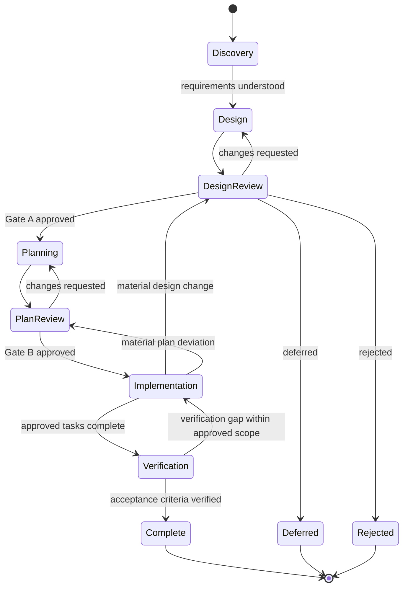

# Mandatory Feature Development Workflow

This document governs new features, material changes to existing features, bug fixes, and hotfixes in TahlilApp-AI (Financial Copilot). It applies to all AI agents and contributors using the repository's feature specifications. `AGENTS.md`, `CLAUDE.md`, and the mirrored spec-driven rules (`.claude/rules/spec-driven-workflow.md`, `.codex/rules/spec-driven-workflow.md`) summarize and point to this process.

## Core Rules

- A feature request starts with discovery. It does not automatically authorize `user-story.md`, `tasks.md`, production code, migrations, or behavior changes.
- Keep **design approval** and **implementation-plan approval** as separate gates. Approval of one never implies approval of the other.
- An approval must be explicit and attributable to the user. Silence, lack of objections, existing files, and earlier approvals for other work are not approval.
- The user may authorize multiple gates in one message only when the message unambiguously approves both the design and the implementation plan. If the plan does not yet exist, present it and obtain approval before implementation.
- Keep English as the default for new workflow documentation, specifications, plans, and tasks. Agent replies follow the "Agent Communication Language" rule in `AGENTS.md`. Preserve Persian UI/localization text, business terms, quoted material, and existing Persian documentation.
- Record assumptions and unresolved business or technical decisions in the relevant proposal and `specs/open-questions.md`; do not invent domain or database facts.
- `specs/implementation-checklist.md` is a historical completion ledger only. It does not select work and does not grant approval. The owner decides which feature is worked on and when.

## Sources of Truth

Check these before designing; do not contradict them silently. If one is missing or wrong, record it in `specs/open-questions.md`.

| Topic | Source |
|---|---|
| Domain terms | `docs/domain-glossary.md` |
| Architecture and layer dependencies | `docs/architecture.md`, `docs/codex-agent-instructions.md`, `.claude/rules/*` |
| Data model | EF Core entities, configurations, and migrations under `src/backend/FinancialCopilot.Infrastructure/**/Persistence/`; `docs/financial-statement-model.md`, `docs/company-master-data-model.md`, `docs/data-strategy.md` |
| External data providers and APIs | `docs/providers/`, provider documents in `docs/` (for example `docs/nadpco-api-provider.md`), and the related specs listed in `specs/README.md` |
| AI query path | `specs/POLICY-V1-FREEZE.md` (new capabilities ship on the V2 path only) |
| Existing features | `specs/README.md` and the feature folders under `specs/` |
| Versions and releases | `CHANGELOG.md`, `docs/release/release-process.md` |

## Lifecycle and Deliverables

### Phase 1 — Discovery and Requirements Analysis

For a new feature or requested change:

1. Understand the business objective, users, desired outcomes, and constraints.
2. Inspect relevant code, architecture, domain model, database sources, existing specifications, and reusable components.
3. Identify dependencies, integration points, external APIs, security considerations, reliability needs, ambiguities, and risks.
4. Ask targeted questions when answers materially affect the scope or design. Record unanswered questions instead of guessing.

**Deliverable:** a discovery summary covering requirements, architecture and domain findings, assumptions, open questions, dependencies, risks, and potential approaches.

**Allowed:** read-only repository and external API research; clarification questions; discovery notes and proposed approaches.

**Do not:** create finalized `user-story.md` or `tasks.md`; make production changes; create migrations.

### Phase 2 — Solution Design

Prepare a proposed design proportionate to the change. Cover applicable topics:

- Business scope and out-of-scope behavior
- Architecture and domain model changes
- Database impact and source-of-truth references
- Backend/frontend components and API contracts
- External integrations
- Security, reliability, and error handling
- Testing and verification strategy
- Alternatives, trade-offs, risks, and dependencies

**Deliverable:** a reviewable design proposal. If persistence is useful, place it at `specs/<feature-folder>/design-proposal.md` and clearly mark it **Proposed — not approved** (see [Recording Approval](#recording-approval)). Create only this proposal during these phases; do not create `user-story.md` or `tasks.md`.

### Phase 3 — Design Review and Approval (Gate A)

Present the design, explain significant decisions, highlight trade-offs and risks, list open questions, and recommend an approach. Stop for explicit user feedback.

Possible outcomes are **Approved**, **Changes requested**, **Rejected**, or **Deferred**. Revise and resubmit when changes are requested. Rejection or deferral ends or pauses the proposed feature without creating implementation specifications.

**Gate A approval is required before finalizing feature `user-story.md` and `tasks.md`.** It approves the design and authorizes detailed planning only; it does not authorize implementation.

### Phase 4 — Detailed Planning

Only after Gate A:

1. Finalize the scope and acceptance criteria.
2. Create or update the feature `user-story.md` and detailed implementation specifications using the existing conventions in `specs/` and the templates in `specs/_template/`.
3. Create `tasks.md` with dependencies, ordered implementation steps, verification requirements, and definition of done.
4. Identify expected files/modules, database changes, security/reliability work, risks, and complexity where useful.

Use the established structure where relevant, creating only needed directories and files. This repository uses one folder per feature, `specs/NNN-<feature-name>/`, covering every affected layer:

```text
specs/NNN-<feature-name>/
  design-proposal.md
  user-story.md
  tasks.md
  changes/
    <kebab-change-name>/
      design-proposal.md
      user-story.md
      tasks.md
```

Layers are named in the user-story header: `backend` (`src/backend`: API, Application, Domain, Infrastructure, Billing, Worker), `database` (EF Core migrations under `src/backend/FinancialCopilot.Infrastructure/**/Persistence/Migrations`), `frontend` (`src/frontend`), `telegram-gateway` (`src/backend/FinancialCopilot.TelegramGateway`), and `ops` (`docker/`, `ops/`, `.github/workflows/`). Split a large feature into layer subfolders (`backend/`, `frontend/`, ...) each with its own `user-story.md` and `tasks.md` only when the approved plan says so.

Older feature folders use other file names (`spec.md`, `design.md`, `discovery.md`, `plan.md`, `ImplementationReport.md`). Keep them; do not rewrite or reorganize existing feature folders unless that change is explicitly part of an approved plan.

### Phase 5 — Plan Review and Approval (Gate B)

Present the completed plan with scope, expected files/modules, database impact, task breakdown, dependencies, implementation order, acceptance criteria, tests, risks, and blockers. Wait for explicit user approval of the **implementation plan**.

**Gate B approval is required before modifying production code, database migrations, or application behavior.** Design approval alone is insufficient. If the user requests changes, revise the plan and obtain approval again.

Gate B does not authorize a release, a `v*` tag, or a production deploy. Those follow `docs/release/release-process.md` and need the owner's separate go-ahead.

### Phase 6 — Implementation

After Gate B:

1. Implement the approved tasks in dependency order and within approved scope.
2. Reuse established architecture and conventions; update task status as work is completed.
3. Add or update tests and run the relevant builds, tests, and verification steps in the approved plan.
4. Report blockers and deviations. Pause affected work if an assumption fails or the approved design cannot be followed.

Stop and seek renewed approval before a material design change, new scope, or significant implementation-plan deviation. Do not silently expand scope.

### Phase 7 — Verification and Completion

Verify acceptance criteria; run the planned tests and builds; review security and reliability; validate migrations and layer integration when applicable; update reference documentation; and record remaining issues. Provide a final report listing completed work, verification evidence, deviations, and outstanding items. Do not claim completion for unverified acceptance criteria.

## Allowed Actions by Phase

| Phase | Allowed actions | Prohibited actions |
|---|---|---|
| **1. Discovery** | Read-only research, inspect current code/specs/domain/database, ask questions, record findings and risks | Final `user-story.md`/`tasks.md`, migrations, or production changes |
| **2. Solution Design** | Draft and revise a clearly marked proposed design; compare alternatives and present recommendations | Treating a proposal as approved; final implementation specifications or production changes |
| **3. Design Review (Gate A)** | Present the design, answer questions, revise and resubmit, record approved/rejected/deferred outcome | Proceeding to finalized feature specifications without explicit Gate A approval; implementation |
| **4. Detailed Planning** | After Gate A, finalize scope, create/update stories and tasks, define acceptance/verification | Production code, migrations, or application behavior changes |
| **5. Plan Review (Gate B)** | Present the complete implementation plan, answer questions, revise and resubmit | Starting implementation before explicit approval of the plan |
| **6. Implementation** | After Gate B, implement and verify approved tasks, update task status, report blockers and deviations | Unapproved scope expansion, material design changes, or significant plan deviations |
| **7. Verification** | Validate acceptance criteria, run planned checks, update references, report results and remaining issues | Claiming completion for unverified criteria or adding unapproved behavior during verification |

## Approval Gates at a Glance

| Gate | Required approval | Authorizes | Does not authorize |
|---|---|---|---|
| **A — Design Approval** | Explicit approval of the proposed design | Finalized feature specifications and detailed planning | Production implementation |
| **B — Implementation Plan Approval** | Explicit approval of the completed detailed plan | Production implementation within the approved scope | Unreviewed material scope or architecture changes |

A request that explicitly authorizes both gates may satisfy them sequentially in one interaction when the complete design and plan have both been presented and unambiguously approved. Never infer the second approval from the first. Approving Gate A never approves Gate B.

## Recording Approval

Each `design-proposal.md` and `tasks.md` carries a status line directly under its title. The line moves through these values:

```text
Status: Proposed — not approved
Status: Gate A: Approved by <owner> on <YYYY-MM-DD>
Status: Gate B: Approved by <owner> on <YYYY-MM-DD>
```

- `design-proposal.md` starts at `Status: Proposed — not approved` and becomes `Status: Gate A: Approved by <owner> on <YYYY-MM-DD>` after Gate A.
- `tasks.md` is created after Gate A with `Status: Gate A: Approved by <owner> on <YYYY-MM-DD> — plan proposed, Gate B not approved` and becomes `Status: Gate B: Approved by <owner> on <YYYY-MM-DD>` after Gate B.
- Other outcomes use the same form: `Status: Changes requested by <owner> on <YYYY-MM-DD>`, `Status: Rejected by <owner> on <YYYY-MM-DD>`, `Status: Deferred by <owner> on <YYYY-MM-DD>`.
- Write an approval line only after the owner's explicit approval in the conversation, in the same session, with the date of that approval. Never pre-fill, predict, or copy an approval line.
- A status line records an approval; it does not replace one. If a line cannot be traced to an explicit owner approval, treat the work as awaiting review and ask.

## Existing Features and Changes

Do not delete or rewrite existing feature specifications as part of adopting this process. A `user-story.md`, `spec.md`, `tasks.md`, or completed-looking task list (including a ticked row in `specs/implementation-checklist.md`) is not evidence of approval. Establish approval from explicit user approval in the conversation or a recorded approval artifact (see [Recording Approval](#recording-approval)). If approval cannot be established, treat the feature as awaiting review and approval; present its existing proposal/specification for review and fill gaps without starting implementation.

For changes to an existing feature, classify the request before proceeding:

| Change type | Treatment |
|---|---|
| **Minor clarification** | Clarify wording without changing accepted behavior, scope, architecture, or plan. Record the clarification. If it changes interpretation or acceptance criteria materially, return to design review. |
| **Scope change** | Update the design and acceptance criteria; obtain renewed Gate A approval, then update and obtain renewed Gate B approval for the affected plan before implementation. |
| **Architectural change** | Stop affected implementation. Prepare and review the revised design at Gate A, then present the revised plan for Gate B. |
| **Implementation change** | If it remains within approved design, scope, and plan, continue under Gate B. If it changes behavior, planned components, risk, or acceptance criteria materially, stop and obtain renewed approval for the affected gate(s). |

## Changes to Existing Features

Changes and bug fixes to an existing feature live inside that feature's folder:

```text
specs/<feature-folder>/changes/<kebab-change-name>/
  design-proposal.md   # before Gate A, status "Proposed — not approved"
  user-story.md        # after Gate A, only if behavior changes
  tasks.md             # after Gate A, approved at Gate B
```

- `<kebab-change-name>` describes the change, for example `fix-empty-monthly-sales-chart`.
- Do not edit the feature's original `user-story.md`/`spec.md` to describe the change; the change folder records it. Update the original only where the approved plan says so (for example, an acceptance criterion that the change replaces).
- A defect that does not belong to one feature is recorded in `specs/bugs.md` and planned under the feature it affects most, or in a folder named in the plan.

## Bug Fixes and Urgent Hotfixes

- Record defects in `specs/bugs.md` and inspect the affected behavior before proposing a fix. Detailed investigation notes may stay in `specs/bugs/` as before; link them from the `specs/bugs.md` row.
- A bug fix does not need a new feature folder or full user story when it restores behavior already specified and approved. Provide a concise discovery/design summary and a fix plan with affected areas, acceptance criteria, risks, and verification (in `specs/<feature-folder>/changes/<kebab-change-name>/`).
- Obtain explicit design approval (Gate A) for the proposed correction and explicit implementation-plan approval (Gate B) before production changes. For a correction that clearly preserves the approved design, Gate A may be concise and explicitly confirm that no material design change is proposed.
- For an urgent hotfix, compress the discovery, design, and plan into a focused reviewable proposal. Urgency does not waive either approval gate or authorize unreviewed scope. The user may explicitly approve both gates together if the correction and plan are sufficiently clear.
- If investigation shows the "bug" requires new behavior or materially changes the feature's design, handle it as a scope/design change and use the full lifecycle.

## Definition of Done

A feature or change is complete only when:

- Approved scope and acceptance criteria are met and verified.
- Planned builds, tests, migration checks, security/reliability reviews, and integration checks pass or their limitations are reported.
- Task statuses and relevant reference documentation are current.
- Open questions, deferred work, known defects, and deviations are recorded and reported.
- The final implementation report distinguishes verified results from remaining work.

## Permitted Phase Transitions


